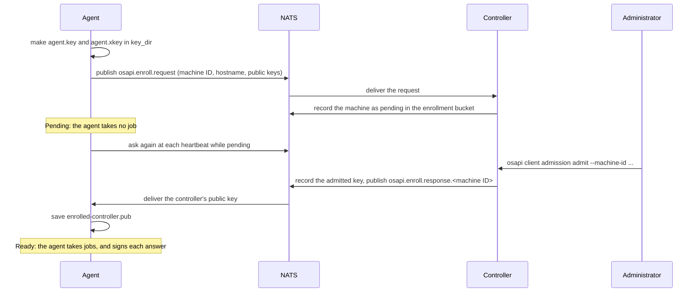
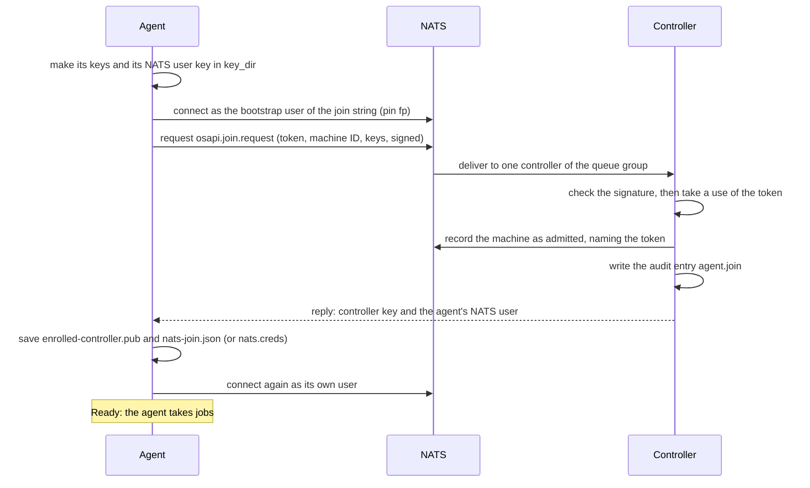
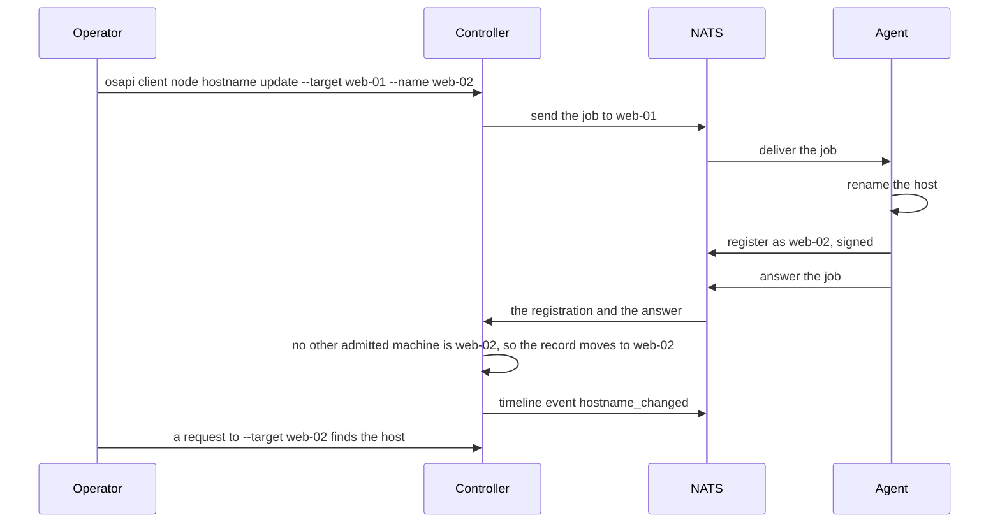

# Agent identity and PKI

An osapi agent identifies itself with a permanent machine ID. As an option, PKI
enrollment gives cryptographic trust between the agents and the controller.

## Machine identity

Each agent has two identity values:

- **Machine ID.** A permanent identifier from `/etc/machine-id` (Linux) or
  `IOPlatformUUID` (macOS). It is the registry key. It does not change when the
  hostname changes.
- **Hostname.** A display name from the OS or from the `agent.hostname` config.
  It can change. Use it to target hosts and to read the output.

The agent reads its machine ID one time, when it starts. If it cannot read the
machine ID, it does not start. NATS subjects use the machine ID
(`jobs.query.host.<machineID>`). Thus the consumers do not subscribe again when
the hostname changes. The agent reads the hostname again at each heartbeat (10s)
and updates it in the registry.

### CLI targeting

A hostname and a machine ID both work as targets. The controller changes a
hostname to the machine ID for the NATS subject automatically:

```bash
# Target by hostname
osapi client node hostname --target web-01

# Target by machine ID
osapi client node hostname --target a1b2c3d4e5f6

# Broadcast to all agents
osapi client node hostname --target _all

# Target by label
osapi client node hostname --target group:web.dev
```

The output of `node list` and `node get` has the machine ID. Thus an operator
can identify an agent when its hostname changes. The management dashboard shows
the machine ID and the fingerprint on the agent cards. Use the Admin >
Enrollment page to manage pending agents.

## PKI enrollment

PKI is always on. osapi uses Ed25519 key pairs. They give each agent a
cryptographic identity, and they sign the jobs. An agent takes no job until the
controller admits it.

### Enrollment flow

Enrollment uses an accept and reject model, like Salt:



With `controller.pki.auto_admit`, the controller admits each request at once,
with no administrator. A join token also admits at once
([Join with a token](#join-with-a-token)).

1. **The agent makes its keys.** When the agent starts for the first time, it
   makes two keys in `agent.pki.key_dir` (`/etc/osapi/pki/agent` by default):

   | File         | Mode | Key                                            |
   | ------------ | ---- | ---------------------------------------------- |
   | `agent.key`  | 0600 | Ed25519 signing key. It signs results.         |
   | `agent.pub`  | 0644 | The public half of the signing key.            |
   | `agent.xkey` | 0600 | X25519 encryption key, as an nkeys curve seed. |

   One key does not do both jobs. The signing key signs. The encryption key
   opens the secrets that the controller seals for this agent
   ([Secrets](../operate/secure/secrets.md#sealed-values)). The agent makes each
   key only when its file does not exist.

   The user that runs the agent must own the directory. The agent does not
   replace a key that it cannot read, or half of a key pair, or an `agent.xkey`
   that is not a curve seed. It writes the error to the log and stops. A new key
   is not the key that the controller accepted. Thus a host with a replaced key
   gets no work until you enroll it again. If you change the user of the agent,
   also change the owner of the directory (`chown -R osapi /etc/osapi/pki`).

1. **The agent sends an enrollment request.** It publishes a request to the
   controller through NATS. The request has its machine ID, hostname, the two
   public keys and the fingerprint. The fingerprint is the SHA-256 of the
   Ed25519 public key, then the X25519 public key. Thus the administrator who
   admits the fingerprint admits the two keys. The controller does not keep a
   request without an encryption key. An agent older than the controller sends
   that request. Upgrade the agent.

1. **The agent waits.** The controller stores the request in a JetStream KV
   bucket. The agent goes into the pending state and waits. **It publishes its
   request again at each heartbeat** until the controller accepts it.

   The first request goes over core NATS, which does not guarantee delivery. If
   the controller was down or a publish failed, the controller did not know the
   agent, and the agent stayed pending. A pending agent does not take jobs. Thus
   that state stayed until somebody restarted the process. The repeated request
   also fixes a controller that lost its pending entries. It is safe, because
   the controller keys acceptance by machine ID. The controller writes over the
   pending entry. It does not add one entry for each attempt.

1. **An administrator accepts the agent.** An administrator examines the pending
   agents, and accepts or rejects them with the CLI. When the controller accepts
   an agent, it sends back its own public key.

1. **The agent is ready.** The agent saves the public key of the controller as
   `enrolled-controller.pub`, and starts to verify job signatures. At the next
   restarts, the agent loads the controller key from disk and does not enroll
   again.

### An agent admitted before the encryption key

An agent that was admitted before agents had an encryption key makes
`agent.xkey` when you upgrade it. Its fingerprint changes, and its admitted
record has no encryption key. Enroll it again:

1. On the machine, delete `enrolled-controller.pub` in `agent.pki.key_dir`
   (`controller.pub` on an agent admitted before osapi-io/osapi#1398), and
   restart the agent. It sends a new request with the two keys.
1. On the machine, run `osapi pki key get --name agent`.
1. Admit the machine with that fingerprint. The pending record shows the old
   fingerprint as `previous_fingerprint`.

### Join with a token

An agent can join with a join token in place of a request that waits for an
administrator. The administrator makes the token on the controller, and gives
the agent the join string that the command prints. The agent then needs the join
string and nothing else: no NATS settings and no credentials.

```bash
osapi controller join token create --expires 1h --uses 1
```

```yaml
agent:
  join: tls://nats.example.com:4222?fp=SHA256%3A...&ns=osapi&pass=...&token=osapi_jt_...&user=join
```

At its first start, an agent with a join string for NATS does these steps:

1. It makes its signing key and its encryption key in `agent.pki.key_dir`.
1. It connects to NATS as the bootstrap user of the string. That user can send
   the join request and nothing else. For a `tls://` server, the agent refuses a
   certificate whose fingerprint is not the one in the string.
1. It sends the join request: the token, its machine ID, its hostname and its
   two public keys, signed with its signing key.
1. A token that has not expired, has uses left and was not revoked admits the
   machine at once. The admission record names the token, as `join_token` in
   `osapi client admission get`.
1. The controller replies with its key and the agent's own NATS user. The agent
   saves the key as `enrolled-controller.pub`, and the user and the server's
   certificate in `nats-join.json` (mode 0600), connects with its own user, and
   starts to take jobs. Each later start reads `nats-join.json`, and does not
   join again.



The bootstrap user can send the join request, and nothing else. A join that
fails, such as with an expired token, stops the agent with the reason. The join
string sets the address of NATS: `controller.join.url`, or else
`nats.server.url`. The users default to the users of `nats.server.auth.users`
with the roles `join` and `agent`, or set `controller.join.user` and
`controller.join.agent` for a server that osapi does not run.

With `--transport https`, the agent joins over the controller's API in place of
NATS. The string is
`osapi://controller.example.com:8080?fp=SHA256%3A...&token=osapi_jt_...`, the
agent sends `POST /api/agent/join`, and it needs its NATS settings in its
config. A join over HTTPS that fails makes the agent ask to be admitted over
NATS, as above. The controller needs `controller.api.tls.enabled` for it,
because the join string pins the API's certificate.

### Auto-admit mode

For development and tests, set `controller.pki.auto_admit: true`. Then the
controller admits each machine that asks to join, without an administrator. Do
not use this in production.

### Commands

[4. Join hosts](../operate/join.md) has the commands that admit, reject, revoke
and delete a host, and that make a join token.

## Job signing

The controller signs each job payload with its Ed25519 private key before it
stores the job in the KV bucket. The payload is in a `SignedEnvelope`:

```json
{
  "payload": "<raw job JSON>",
  "signature": "<Ed25519 signature bytes>",
  "fingerprint": "sha256:a1b2c3..."
}
```

Agents also sign their job responses with their own key pair before they write
them to the KV bucket. They use the same envelope.

### Verification and failures

The agent verifies the envelope of each job before it runs the operation.
Verification fails closed: the agent rejects the job and does not run it unless
the job passes all checks. The agent writes one of three reasons to the log and
records it as the termination reason of the job. Thus an operator can tell them
apart:

- **Not enrolled.** The agent has no controller public key yet, because
  enrollment is pending or did not complete. osapi reports this separately from
  a bad signature, because it means "not trusted yet", not "somebody changed
  this job".
- **Missing or malformed signature.** The job data is not in a signed envelope,
  or the envelope has no value in a required field.
- **Invalid signature.** The signature of the envelope does not verify with the
  controller key of the agent, or with the previous key during a rotation grace
  period. Refer to [Key rotation](#key-rotation).

The controller also verifies the signature on the job response of an agent
before it uses it as a result. A response that fails verification is a failed or
missing result, never a successful result.

## Registration signing

An agent sends more than job responses. At each heartbeat, it writes its own
entry in the agent registry again. Targeting reads that entry. It reads the
hostname that a job names and the labels that a label target selects. It also
reads the scheduling state, which decides if the agent can get work.

The agent signs the routing fields of its registration with its own key pair.
The signature includes:

| Field         | Why the agent signs it                                              |
| ------------- | ------------------------------------------------------------------- |
| `machine_id`  | It selects the stored key that checks the signature                 |
| `hostname`    | A job names it. A false one sends the work of that host elsewhere   |
| `fingerprint` | The fleet view shows it as the key of this agent                    |
| `state`       | osapi refuses work to a `Pending` agent. A false `Ready` stops that |
| `labels`      | A label target uses them. A false label gets jobs                   |

The other fields of a registration, for example uptime, load, memory and
conditions, only report data. They do not route work, and the agent does not
sign them. The signature is next to these fields, not in the signed bytes.

### A hostname that changes

The machine ID and the key are the identity, and the hostname follows the
machine. A rename through osapi, by hand, or by a rebuild that keeps the machine
ID keeps the machine admitted, and the host keeps its timeline.



The controller refuses the new hostname when another admitted machine holds it.
Then the registration is not verified, and the host gets no work by that name.

### What the controller checks

When the controller has a key for the agent, it verifies each registration
before it uses the registration for a decision:

1. The machine ID selects the stored record. The controller checks a
   registration that names a different agent with the key of **that** agent. It
   fails unless that agent signed it.
1. The signature must verify with the key that the controller recorded when it
   accepted the enrollment of the agent.
1. The hostname must be the hostname that the controller recorded at acceptance.
   An accepted agent cannot answer for a host that it did not enroll as.

When a registration fails a check, the controller does not return an error to
the agent. The agent continues its heartbeats and stays in the list, but its
registration does not decide anything. Target resolution, label matching and
machine-ID targets do not see it. Work for that hostname continues to go to the
agent that enrolled with it.

When more than one agent claims a hostname, the result is always the same: the
lowest machine ID wins. The order of the registry list does not decide.

### Check the state of a fleet

`osapi client agent list` and `GET /agent` report two separate fields for each
agent:

| Field        | Meaning                                                           |
| ------------ | ----------------------------------------------------------------- |
| `key_stored` | The controller has the key of this agent, from acceptance         |
| `verified`   | That key signed the last registration, and it claims its own host |

They answer different questions. `key_stored: false` means that the agent did
not enroll after the key store started. This is normal during a rollout. To fix
it, enroll the agent again. `key_stored: true` with `verified: false` means that
the controller can check this agent, and the data that arrived did not pass the
check. Examine it. Do not wait.

## Key rotation

The controller can change its Ed25519 key pair. During a grace period (`24h` by
default), agents accept signatures from the old key and from the new key of the
controller. You can configure the grace period.

To rotate the key:

1. Make a new controller key pair. Replace the files in
   `controller.pki.key_dir`.
1. Restart the controller. It loads the new key and starts to sign with it.
1. The enrolled agents still have the old public key of the controller. The
   `VerifyWithGrace` method checks the signature with the current key and with
   the previous key of the controller.
1. During the grace period (`controller.pki.rotation_grace_period`), the agents
   get the new public key of the controller in an updated enrollment response.
   Then they change to the new key.
1. After the grace period, osapi accepts only the new key.

## Upgrade a fleet

PKI is always on, and the settings `controller.pki.enabled` and
`agent.pki.enabled` do not exist. Remove them from `osapi.yaml`: the config
check refuses a key that it does not know. Do these steps in this order:

1. Upgrade the controller. It makes its key pair in `controller.pki.key_dir` at
   its first start, and signs each job from then on.
1. Upgrade each agent. At its first start, the agent makes its keys in
   `agent.pki.key_dir` (`/etc/osapi/pki/agent` by default), and asks to join. It
   takes no job until the controller admits it.
1. Admit each agent: read `osapi client admission list --state pending`, and
   admit each machine with the fingerprint that `osapi pki key get --name agent`
   prints on it. Set `controller.pki.auto_admit` only on a test fleet.

By default the agent and the controller use one key directory, `/etc/osapi/pki`.
The controller keeps its own key pair there as `controller.key` and
`controller.pub`. The agent keeps the key that the controller sent it as
`enrolled-controller.pub`. Thus an agent on the controller's host does not take
the controller's own `controller.pub` as proof that it was admitted. Before
osapi-io/osapi#1398 the agent used `controller.pub`, so it skipped enrollment on
that host and no job ran. An agent admitted before then still reads its
`controller.pub`, but only when no `controller.key` is beside it.

## Configuration

### Agent PKI

<!-- osapi:config agent.pki -->

| Key                 | Type   | Default                | Environment               | Description                        |
| ------------------- | ------ | ---------------------- | ------------------------- | ---------------------------------- |
| `agent.pki.key_dir` | string | `/etc/osapi/pki/agent` | `OSAPI_AGENT_PKI_KEY_DIR` | Directory of the agent's key pair. |

<!-- /osapi:config -->

### Controller PKI

<!-- osapi:config controller.pki -->

| Key                                    | Type   | Default                                          | Environment                                  | Description                                                                                                       |
| -------------------------------------- | ------ | ------------------------------------------------ | -------------------------------------------- | ----------------------------------------------------------------------------------------------------------------- |
| `controller.pki.key_dir`               | string | `/etc/osapi/pki`                                 | `OSAPI_CONTROLLER_PKI_KEY_DIR`               | Directory for controller keypair storage.                                                                         |
| `controller.pki.auto_admit`            | bool   | `false`                                          | `OSAPI_CONTROLLER_PKI_AUTO_ADMIT`            | Admit each machine that asks to join, with no operator (dev/test only).                                           |
| `controller.pki.rotation_grace_period` | string | `24h`                                            | `OSAPI_CONTROLLER_PKI_ROTATION_GRACE_PERIOD` | Grace period during key rotation where both old and new keys are accepted. Go duration format.                    |
| `controller.pki.delete_after`          | string | none: empty keeps a machine that stops reporting | `OSAPI_CONTROLLER_PKI_DELETE_AFTER`          | Delete an admitted machine that has not reported for this long, such as 720h. Empty is never. Go duration format. |

<!-- /osapi:config -->

## What does not change

- **JWT authentication.** The HMAC-SHA256 JWT tokens for API authentication do
  not change. PKI is an additional trust layer between the controller and the
  agents. It does not replace JWT.
- **NATS transport.** NATS connections still use their own authentication
  (`none`, `user_pass`, `nkey` or `creds`). PKI operates on the job payloads,
  not on the transport.
