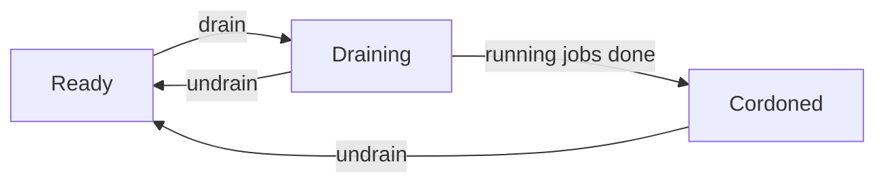
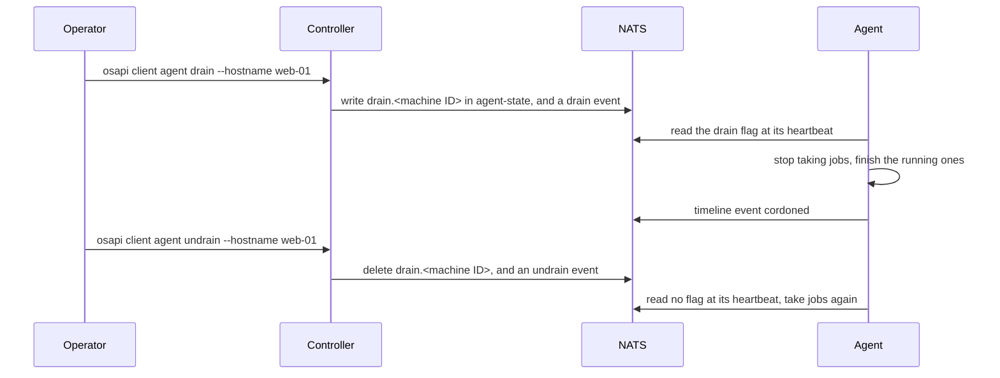

# Agent lifecycle

osapi agents report **node conditions** that compare values with limits. You can
also **drain and cordon** an agent cleanly for maintenance. The two features
come from the node management of Kubernetes.

## Node conditions

A condition is a boolean that compares a value with a limit. The agent
calculates the conditions at each heartbeat (10 seconds). They show if something
is wrong. The operator does not need to read the raw metrics.

| Condition              | Default Threshold                          | Data Source      |
| ---------------------- | ------------------------------------------ | ---------------- |
| `MemoryPressure`       | Memory used > 90%                          | Heartbeat memory |
| `HighLoad`             | Load1 > 2x CPU count                       | Heartbeat load   |
| `DiskPressure`         | Any disk > 90% used                        | Heartbeat disk   |
| `DrainStuck`           | A drain waits for its consumers > 1m       | Drain            |
| `ConsumersUnavailable` | A job consumer cannot be made or bound     | Job consumers    |
| `KeyMismatch`          | The agent's keys are not the admitted keys | The controller   |

The agent evaluates each condition at each heartbeat, and keeps:

- **Reason**: an explanation for a person, for example "memory 94% used,
  15.1/16.0 GB"
- **LastTransitionTime**: the last time that the condition started or stopped

`DrainStuck` holds while a drain waits for the consumers of the agent to stop
for more than one minute. While it holds, the agent stays `Draining` and does
not change to `Cordoned`. The agent logs a warning and continues to wait.

`ConsumersUnavailable` holds while a JetStream consumer of the agent does not
run, for example when the stream has its maximum number of consumers. The reason
gives the number of consumers and the error of one of them. The agent logs the
error and tries again each 10 seconds. While the condition holds, the agent can
miss jobs, and a broadcast can show a `timeout` row for it.

`KeyMismatch` is the one condition that the controller sets, not the agent. It
holds while the fingerprint of the keys that the agent reports is not the
fingerprint that the controller admitted for its machine, for example after the
agent made new keys in a different key directory. The controller refuses each
result that the agent signs, so each job to the agent fails. The agent then
shows `Refused`, not `Ready`. The reason gives both fingerprints. Remove the
machine's admission and let it join again, or give the agent back its admitted
keys.

The API and the CLI show only the conditions that hold now. A condition that
does not hold is not in the answer. The notifier uses the full list of the
agent, so it also sees when a condition stops.

### CLI display

`agent list` shows the conditions that hold in the CONDITIONS column:

```
HOSTNAME  MACHINE ID  STATE  CONDITIONS                LABELS  AGE    LOAD            OS            VERSION
web-01    m-1         Ready  HighLoad, MemoryPressure          3d 4h  4.12 3.90 3.71  Ubuntu 24.04  v1.4.0
web-02    m-2         Ready  -                                 12h    0.31 0.28 0.25  Ubuntu 24.04  v1.4.0
db-01     m-3         Ready  DiskPressure                      5d     1.22 1.10 1.05  Ubuntu 24.04  v1.3.2
```

The VERSION column is the build of each agent. During an upgrade, it shows which
agents run the new build. The STATE column is the scheduling state: `Ready`,
`Draining`, `Cordoned` or `Pending`.

`agent get` shows each condition that holds, with its reason:

```
Conditions (2):
  TYPE            REASON                                SINCE
  MemoryPressure  memory 94% used (15.1/16.0 GB)        2m
  HighLoad        load 4.12, threshold 4.00 for 2 CPUs  5m
```

### Configuration

Set the limits in `osapi.yaml`:

<!-- osapi:config agent.conditions -->

| Key                                          | Type  | Default | Environment                                        | Description                               |
| -------------------------------------------- | ----- | ------- | -------------------------------------------------- | ----------------------------------------- |
| `agent.conditions.memory_pressure_threshold` | int   | `90`    | `OSAPI_AGENT_CONDITIONS_MEMORY_PRESSURE_THRESHOLD` | Memory pressure threshold (percent used). |
| `agent.conditions.high_load_multiplier`      | float | `2`     | `OSAPI_AGENT_CONDITIONS_HIGH_LOAD_MULTIPLIER`      | High load multiplier (load1 / cpu_count). |
| `agent.conditions.disk_pressure_threshold`   | int   | `90`    | `OSAPI_AGENT_CONDITIONS_DISK_PRESSURE_THRESHOLD`   | Disk pressure threshold (percent used).   |

<!-- /osapi:config -->

## Agent drain

A drain removes an agent cleanly from the agents that get jobs, for maintenance.
The process continues to run. If an agent stops without a drain, it goes from
the registry, and that looks the same as a crash.

### State machine

Agents have an explicit scheduling state with three values:



| State      | Meaning                                         |
| ---------- | ----------------------------------------------- |
| `Ready`    | Accepts and processes jobs (default)            |
| `Draining` | Completes its running jobs, accepts no new jobs |
| `Cordoned` | Fully drained and idle, accepts no jobs         |

### How it works

1. The operator runs `osapi client agent drain --hostname web-01`.
1. The API writes a `drain.<machine ID>` key to the state KV bucket.
1. The agent finds the drain flag at its next heartbeat (10s).
1. The agent changes to `Draining` and **stops its NATS JetStream
   subscriptions**. Thus it gets no new jobs.
1. The running jobs continue until they are complete.
1. When all running jobs are complete, the state changes to `Cordoned`.
1. The operator runs `osapi client agent undrain --hostname web-01`.
1. The API deletes the drain key. The agent subscribes again and changes to
   `Ready`.



### Timeline

The agent records each change of state as an event in the state KV bucket
(`agent-state`, no TTL), under its machine ID. It only adds events, and does not
change them. A rename keeps the timeline, and each event keeps the hostname that
the agent had then. `agent get` shows all the changes:

```
Timeline:
  TIMESTAMP              EVENT                 HOSTNAME  MESSAGE
  2026-03-05 09:58:10    enrollment_requested  web-01    asked to be admitted, fingerprint SHA256:9f86d0...
  2026-03-05 09:58:10    admitted              web-01    admitted by join token 1a2b3c4d
  2026-03-05 09:58:11    started               web-01    started, version v1.4.0
  2026-03-05 10:00:00    drain                 web-01    Drain initiated
  2026-03-05 10:05:23    cordoned              web-01    All jobs completed
  2026-03-05 12:00:00    undrain               web-01    Resumed accepting jobs
```

The timeline also has the lifecycle of the machine. The controller writes each
decision of admission, and the agent writes its own start and stop:

| Event                  | Written by | Message                                                                  |
| ---------------------- | ---------- | ------------------------------------------------------------------------ |
| `enrollment_requested` | controller | the fingerprint of the request: the first request, or one with a new key |
| `admitted`             | controller | by an operator, by `auto_admit`, or by join token `<id>`                 |
| `rejected`             | controller | by an operator, with the reason                                          |
| `revoked`, `deleted`   | controller | by an operator, or for `deleted` by `delete_after` with when it was seen |
| `hostname_changed`     | controller | the old and the new hostname                                             |
| `started`, `stopped`   | agent      | its version, at a start                                                  |
| `config_applied`       | agent      | the version of its config and its labels, when the labels changed        |
| `labels_changed`       | agent      | the old and the new labels, from `agent.labels` at a start               |
| `os_changed`           | agent      | the old and the new OS and version, such as after an upgrade             |
| `address_changed`      | agent      | the old and the new IPv4 address of the interface of the default route   |
| `condition_started`    | agent      | the condition and its reason, such as `MemoryPressure: 92% used`         |
| `condition_cleared`    | agent      | the condition                                                            |

The agent compares each heartbeat and each facts report with the one before.
After a start, the one before is the registration and the facts that the buckets
still hold, so a change while the agent was down, such as an OS upgrade, is an
event. An agent with no report before has no change events: its first heartbeat
is where the comparison starts. A change of the labels that the controller's
config makes is in `config_applied`, so it has no `labels_changed` of its own.

The state of the agent comes from the latest drain event (`drain`, `cordoned`,
`undrain`). A lifecycle event after a drain does not end the drain.

### CLI commands

```bash
osapi client agent drain --hostname web-01     # start draining
osapi client agent undrain --hostname web-01   # resume accepting jobs
```

The two commands return the current state and a confirmation message.

## Permissions

The [agent](../reference/endpoints/fleet/agent.md) and
[admission](../reference/endpoints/fleet/admission.md) reference pages give the
permission of each method.

## Related

- [Agent CLI Reference](../usage/cli/client/agent/agent.mdx): agent fleet
  commands
- [Node Management](../features/node/node-management.md): node queries via the
  job system
- [Job System](../features/platform/job-system.md): how async job processing
  works
- [Configuration](../operate/plan.md#the-config-file): full configuration
  reference
