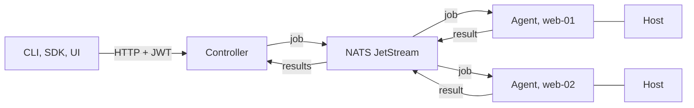

# Architecture

osapi manages Linux and macOS hosts through typed operations. A client sends a
request to the controller for one host, a group of hosts or all the hosts. The
controller checks the identity of the client and the request. Then it puts the
request on NATS as a job. An agent on each host receives the job, does the work
and sends back the result. The controller does not change a host itself. Thus
the controller needs no privileges on a host.

osapi divides what it can do to a host into behaviors, for example kernel
parameters, packages, users and DNS. A behavior is one definition in Go. osapi
builds these parts of the behavior from that definition:

- the API routes and the CLI commands
- the OpenAPI spec and the docs pages
- the settings, the permissions and the tests

The older parts of osapi are domains that people wrote by hand. osapi moves them
to behaviors one at a time. A behavior and a domain look the same to a client.

## This section

| Page                                  | What it explains                                                        |
| ------------------------------------- | ----------------------------------------------------------------------- |
| [Components](components.md)           | The NATS server, the controller and the agent: what each runs and needs |
| [How a request runs](request-flow.md) | From a command to a result: auth, targeting, jobs, statuses, broadcast  |
| [Behaviors](behaviors.md)             | What a behavior is and what is built from one                           |
| [State and storage](state.md)         | Every stream and bucket osapi keeps, and what losing each one means     |
| [Security](security.md)               | Tokens and roles, agent identity, signing, privileges, audit            |
| [Secrets](secrets.md)                 | Where osapi keeps a secret now, and what is in progress                 |
| [Observability](observability.md)     | Traces, metrics, logs, health, heartbeats and conditions                |
| [NATS subjects and roles](nats.md)    | What each process can use on NATS, and why the join has its own user    |
| [Agent identity](agent-identity.md)   | Machine IDs, keys, enrollment, job and registration signing             |
| [Agent lifecycle](agent-lifecycle.md) | Conditions, drain and the timeline of an agent                          |
| [UI](ui.md)                           | The embedded management dashboard                                       |

These pages tell how osapi works. [Operate](../operate/operate.mdx) tells what
to run. The design of each part, and the reason for it, is in the
[osapi specifications](https://github.com/osapi-io/specs/tree/main/components/osapi).
Each page links to the parts that it summarizes.
[Features](../features/features.mdx) tells what each operation does. Each
behavior has its own page under
[Behaviors](../reference/behaviors/behaviors.mdx).
