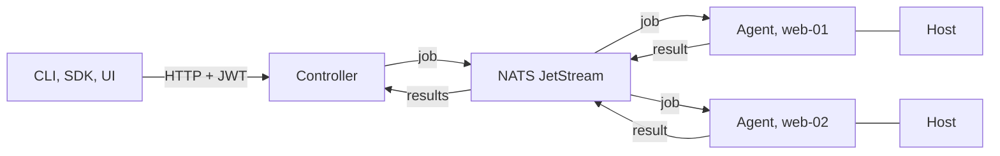

# Architecture

osapi manages Linux hosts through typed operations. A client asks the controller
to do something to one host, a group or the whole fleet. The controller checks
who is asking and what they asked for, and turns the request into a job on NATS.
An agent on each host picks the job up, does the work, and writes back what
happened. The controller never touches a host itself, so it needs no privileges
on one.

What osapi can do to a host comes in units called behaviors: kernel parameters,
packages, users, DNS and so on. A behavior is one definition in Go, and its API
routes, CLI commands, OpenAPI spec, docs pages, settings, permissions and tests
are all built from that definition. The older areas are hand-written domains
that are being moved to behaviors one at a time; to a caller both look the same.

## This section

| Page                                  | What it explains                                                        |
| ------------------------------------- | ----------------------------------------------------------------------- |
| [Components](components.md)           | The NATS server, the controller and the agent: what each runs and needs |
| [How a request runs](request-flow.md) | From a command to a result: auth, targeting, jobs, statuses, broadcast  |
| [Behaviors](behaviors.md)             | What a behavior is and what is built from one                           |
| [State and storage](state.md)         | Every stream and bucket osapi keeps, and what losing each one means     |
| [Security](security.md)               | Tokens and roles, agent identity, signing, privileges, audit            |
| [Observability](observability.md)     | Traces, metrics, logs, health, heartbeats and conditions                |
| [Deployment](deployment.md)           | One host, many hosts, an external NATS cluster, namespaces              |
| [UI](ui.md)                           | The embedded management dashboard                                       |

These pages describe the system as an operator runs it. How each part is
designed, and why, is in the
[osapi specifications](https://github.com/osapi-io/specs/tree/main/components/osapi);
each page links to the parts it summarises. What each operation does is in
[Features](../features/features.md), and every behavior has its own page under
[Behaviors](../behaviors/behaviors.mdx).
