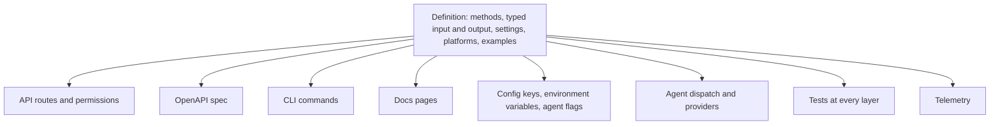
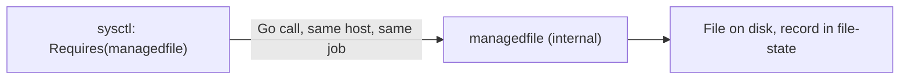

# Behaviors

A behavior is one thing that osapi manages on a host, for example kernel
parameters. A contributor writes it one time, as a Go definition in
`internal/behaviors/<name>/`. osapi builds from that definition all the parts
that the rest of the system needs. Thus a behavior looks the same in the API,
the CLI, the SDK, the docs and the agent.

## What a definition holds

- **Methods.** Each method is a read or a write, with an input type and an
  output type. The verb and the name set the HTTP method, the route, the command
  and the permission. For example, the `update` method of sysctl is
  `PUT /api/node/{hostname}/sysctl/{key}` and `osapi client node sysctl update`,
  and it needs `sysctl:write`.
- **Tags on the types.** They give the names, the descriptions and the
  validation rules. osapi makes from them the request fields, the CLI flags, the
  schemas of the spec and the table columns.
- **Settings.** These are the agent configuration of the behavior, under
  `behaviors.<name>`. Each setting has an environment variable and an
  `osapi agent start` flag.
- **Requirements.** These are the other behaviors that the behavior uses. It
  calls their methods on the same host.
- **Platforms.** For each platform, for example Debian, the definition tells how
  to make the provider that does the work. On a platform that the behavior does
  not declare, its methods report `skipped`. They do not fail.
- **The programs that it runs with sudo.** The preflight of the agent checks
  them.
- **Examples and refusals.** An example is a sample call with the changes that
  it makes on the host. A refusal is a call that the method rejects. osapi makes
  the docs pages and the tests from them.

## What it means for an operator

- **The binary describes itself.** `osapi dsl behavior list` and
  `osapi dsl behavior get --name <name>` show each behavior that this build has:
  its routes, permissions, platforms, settings and types. You do not need to
  look in a different place, and the answer always agrees with the build that
  you run.
- **The permissions come from the methods.** The permissions of a behavior are
  `<name>:read` and `<name>:write`. The built-in roles give them.
  `osapi controller role list` lists each permission of each role.
- **Skipped is not failed.** In a fleet with more than one platform, the hosts
  that a behavior does not run on report `skipped`. When the agent starts, it
  writes to the log the behaviors that it cannot run.
- **Settings are agent configuration.** `osapi config list` shows them with the
  other settings, with their environment variables and flags.
- **The telemetry is the same for each behavior**: one span for each call, and
  three metrics. [Observability](observability.md) describes them.

## Behaviors built on other behaviors

A behavior can use other behaviors. sysctl writes one file for each kernel
parameter. A different behavior, `managedfile`, keeps the files that osapi wrote
apart from the files of other tools:

- **The definition declares it.** The definition of sysctl has
  `behavior.Requires(managedfile)`.
- **The agent makes the provider of the required behavior first.** Then it gives
  that provider to the behavior that requires it. A method calls the methods of
  the other behavior directly, on the same host and in the same job. Thus there
  is no second job and no extra round trip.
- **A required behavior without a provider on the platform** makes the behavior
  that requires it unsupported there too. Its methods report `skipped`.
- **`dsl behavior validate` fails** when a requirement is not registered, and
  when requirements make a cycle.
- **`dsl behavior get` and the Behaviors pages** show what each behavior uses,
  and what uses it.

The behaviors that a behavior calls, and the ones that they call, are a
**chain**: `dns → netplan → managedfile`. The chain has the name of the behavior
at its top. It is not declared on its own: `Requires` on each behavior makes it.
`osapi dsl chain` shows and checks the chains:

- `osapi dsl chain list` shows each chain as a tree, and what calls each
  building block.
- `osapi dsl chain get --name dns` runs each example of dns on the fake host
  that `go test` uses, and shows each call that it makes: what each call sends
  and gets. Thus it shows what the code does now.
- `osapi dsl chain validate` checks the chain rules. A required behavior is
  registered, and no requirement makes a cycle. An internal behavior has a
  behavior that requires it. A provider calls only the behaviors that its
  behavior requires. An example calls each behavior that a behavior requires.
- `osapi dsl chain spec get` tells how to build a chain, what happens when a
  step fails, and the building blocks of the binary.

A behavior that only other behaviors use is **internal**. `managedfile` has no
route, no command and no permissions, because only other behaviors call it.
`dsl behavior list` and its docs page still show it, with the behaviors that use
it.

A chain across hosts or across steps is a workflow, not a requirement. In a
workflow, the output of one call is the input of the next call.
osapi-orchestrator does workflows.

## Beside the hand-written domains

Behaviors are new. Most of what osapi manages is still in domains that people
wrote by hand. Each domain has its own handler, processor and commands. A domain
moves to a behavior in one change: the behavior goes to `/api` and
`osapi client`, and the hand-written code is deleted. The two never run side by
side. Checks name the code that is left to delete. sysctl is the first behavior.

## Where to read more

- [Behaviors](../reference/behaviors/behaviors.mdx): the page of each behavior
  in this build, generated from its definition.
- [Building a behavior](../development/behaviors.md) and
  [Your first behavior](../development/your-first-behavior.md), for a
  contributor.
- [Behaviors in the specifications](https://github.com/osapi-io/specs/blob/main/components/osapi/behaviors.md)
  and
  [the migration plan](https://github.com/osapi-io/specs/blob/main/components/osapi/behavior-migration.md),
  for the design.
