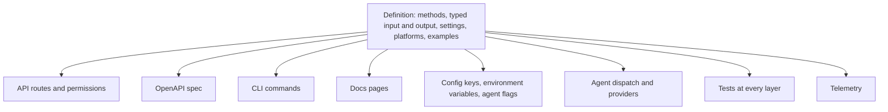
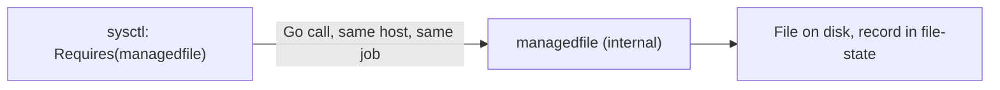

# Behaviors

A behavior is one thing osapi manages on a host, such as kernel parameters,
written once as a Go definition in `internal/behaviors/<name>/`. Everything the
rest of the system needs to offer it is built from that definition, so a
behavior looks the same through the API, the CLI, the SDK, the docs and the
agent.

## What a definition holds

- **Methods**, each a read or a write with an input and an output type. The verb
  and the name decide the HTTP method, the route, the command and the
  permission: sysctl's `update` is `PUT /api/next/node/{hostname}/sysctl/{key}`,
  `osapi client next node sysctl update`, and needs `sysctl:write`.
- **Tags on the types**: names, descriptions and validation rules. They become
  the request fields, the CLI flags, the spec's schemas and the table columns.
- **Settings**, standing configuration of the agent under `behaviors.<name>`,
  each with an environment variable and an `osapi agent start` flag.
- **Requirements**: other behaviors it is built on, whose methods it calls on
  the same host.
- **Platforms**: how the provider that does the work is built on each one, such
  as Debian. On a platform the behavior does not declare, its methods report
  `skipped` rather than failing.
- **The programs it runs with sudo**, which the agent's preflight checks.
- **Examples and refusals**: sample calls with what each changes on the host,
  and calls the method rejects. They are the docs pages and the tests.

## What it means for an operator

- **The binary describes itself.** `osapi behavior list` and
  `osapi behavior get --name <name>` show every behavior this build has: its
  routes, permissions, platforms, settings and types. Nothing needs looking up
  elsewhere, and the answer always matches the build you run.
- **Permissions follow the methods.** A behavior's are `<name>:read` and
  `<name>:write`; the built-in roles grant them, and `osapi token roles` lists
  every permission each role has.
- **Skipped is not failed.** A fleet that mixes platforms reports `skipped` from
  the hosts a behavior does not run on, and the agent logs at startup which
  behaviors it cannot run.
- **Settings are agent configuration.** `osapi config list` shows them beside
  the rest, with their environment variables and flags.
- **Telemetry is the same for every behavior**: a span per call and three
  metrics, described in [Observability](observability.md).

## Behaviors built on other behaviors

A behavior can be built on others. sysctl writes one file per kernel parameter,
and keeping files osapi wrote apart from everyone else's is its own job, done by
the `managedfile` behavior:

- **The definition declares it**: sysctl's has `behavior.Requires(managedfile)`.
- **The agent builds the required behavior's provider first** and hands it to
  the one that requires it. A method then calls the other's methods directly, on
  the same host inside the same job, so there is no second job and no extra
  round trip.
- **A required behavior with no provider on the platform** leaves the one that
  requires it unsupported there too: its methods report `skipped`.
- **`behavior validate`** fails a requirement that is not registered, and a
  cycle.
- **`behavior get` and the Behaviors pages** show what each behavior uses and
  what uses it.

A behavior that exists only to be built on is **internal**: `managedfile` has no
route, no command and no permissions, because only other behaviors call it.
`behavior list` and its docs page still show it, with what uses it.

Chaining across hosts or across steps, where one call's output feeds the next
call's input, is a workflow rather than a requirement, and is
osapi-orchestrator's job.

## Beside the hand-written domains

Behaviors are new. Most of what osapi manages is still hand-written domains,
each with its own handler, processor and commands. While each domain is moved,
its behavior is served beside it, under `/api/next` and `osapi client next`, so
both can be compared on one server; a test holds the two specs to the same API.
At a domain's cutover its behavior moves to `/api` and `osapi client` and the
hand-written code is deleted. sysctl is the first.

## Where to read more

- [Behaviors](../behaviors/behaviors.mdx): the page of each behavior this build
  ships, generated from its definition.
- [Building a behavior](../development/behaviors.md) and
  [Your first behavior](../development/your-first-behavior.md), for a
  contributor.
- [Behaviors in the specifications](https://github.com/osapi-io/specs/blob/main/components/osapi/behaviors.md)
  and
  [the migration plan](https://github.com/osapi-io/specs/blob/main/components/osapi/behavior-migration.md),
  for the design.
