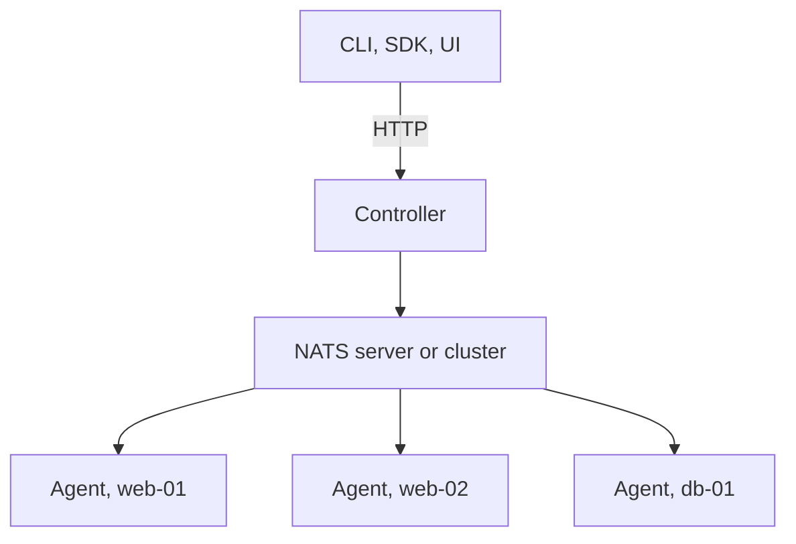

# Deployment

The three processes are the same binary, so a deployment is a choice of where
each runs and which NATS they share. Each reads `osapi.yaml`; every setting can
also come from an `OSAPI_` environment variable, and `osapi config list` shows
what a host ends up with.

## One host

All three processes on the machine being managed, as one process:

```bash
osapi start
```

`osapi start` runs the embedded NATS server, the controller and an agent
together. The CLI on the same host talks to the controller on localhost. This is
the layout for a single appliance and for development.

## A fleet

One controller, one NATS server or cluster, and an agent on every managed host:



- Run `osapi nats server start` on the NATS host, or point at an existing
  cluster, and `osapi controller start` where the API should be served. Both can
  share a host.
- Run `osapi agent start` on each managed host, with `agent.nats` pointing at
  NATS. Give each agent labels, such as `group: web.prod`, to target groups.
- Turn on PKI (`controller.pki.enabled`, `agent.pki.enabled`) so only agents an
  administrator accepted get work, and set NATS authentication so only osapi's
  processes can connect.
- Give the agent `agent.privilege_escalation` and the sudoers drop-in, rather
  than running it as root.

## An external NATS cluster

A fleet in the hundreds, or one whose state must survive losing a host, uses a
NATS cluster rather than the embedded server: JetStream with file storage and
replicas, set in each store's section of `nats`. The controller and agents need
only its address and credentials in `controller.nats` and `agent.nats`; the
embedded server is not started. [State and storage](state.md) lists what each
store holds and what it costs to lose.

## Several deployments on one NATS

Separate fleets, such as staging and production, can share a NATS cluster by
setting a different namespace in each one's `nats.server.namespace`,
`controller.nats.namespace` and `agent.nats.namespace`. The namespace prefixes
every subject and store name, so the fleets never see each other's jobs or
state.

## In a container

The controller and the NATS server run in a container without anything special.
An agent in a container manages the container, not the host, and turns off what
a container cannot do: NTP, timezone, power and service management report
`skipped`. To manage a host, run the agent on the host.

## Checking a deployment

```bash
osapi config validate          # the config file, checked the way start checks it
osapi client health status     # every component and its parts, across hosts
osapi client agent list        # every agent, its labels and conditions
osapi behavior list            # what this build can manage
```

## Design details

- [Configuration](https://github.com/osapi-io/specs/blob/main/components/osapi/configuration.md),
  for how settings are read and checked.
- [Transport](https://github.com/osapi-io/specs/blob/main/components/osapi/transport.md),
  for how the processes connect to NATS.
- [Configuration](../usage/configuration.md), for the commands that show and
  check a host's settings.
