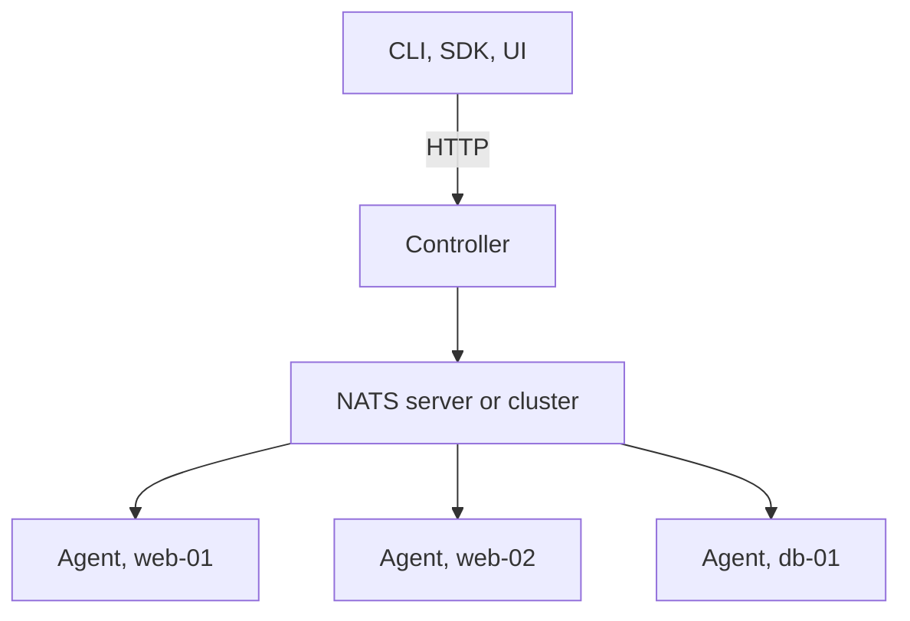

# Deployment

The three processes are the same binary. Thus a deployment is a decision about
where each process runs and which NATS they share. Each process reads
`osapi.yaml`. An `OSAPI_` environment variable can also set each setting.
`osapi config list` shows the settings that a host has.

## One host

Run the three processes on the managed machine, as one process:

```bash
osapi start
```

`osapi start` runs the embedded NATS server, the controller and an agent
together. The CLI on the same host connects to the controller on localhost. Use
this layout for a single appliance and for development.

## A fleet

Use one controller, one NATS server or cluster, and an agent on each managed
host:



1. Run `osapi nats server start` on the NATS host, or use a cluster that exists.
1. Run `osapi controller start` on the host that serves the API. The controller
   and NATS can be on the same host.
1. Run `osapi agent start` on each managed host, with `agent.nats` set to the
   address of NATS. Give each agent labels, for example `group: web.prod`, so
   that you can target groups.
1. Enable PKI (`controller.pki.enabled`, `agent.pki.enabled`). Then only agents
   that an administrator accepted get work.
1. Set NATS authentication. Then only the osapi processes can connect.
1. Give the agent `agent.privilege_escalation` and the sudoers drop-in. Do not
   run it as root.

## An external NATS cluster

Use a NATS cluster, not the embedded server, for a fleet of hundreds of hosts.
Also use one when the state must stay when you lose a host. Use JetStream with file
storage and replicas, and set them in the section of each store in `nats`.

The controller and the agents need only the address and the credentials of the
cluster, in `controller.nats` and `agent.nats`. The embedded server does not
start. Thus run `osapi nats setup` one time to make the streams and buckets of
osapi on the cluster.

A cluster in operator (JWT) mode gives each process its own credentials file,
`auth.type: creds`. To add a host, you give it a credential. You do not change
the server. [State and storage](state.md) lists what each store holds, and what
occurs when you lose it.

## More than one deployment on one NATS

Different fleets, for example staging and production, can share a NATS cluster.
Set a different namespace for each fleet in `nats.server.namespace`,
`controller.nats.namespace` and `agent.nats.namespace`. The namespace is a
prefix on each subject and each store name. Thus a fleet does not see the jobs
or the state of another fleet.

## In a container

The controller and the NATS server run in a container without special
configuration. An agent in a container manages the container, not the host. It
disables what a container cannot do: NTP, timezone, power and service
management report `skipped`. To manage a host, run the agent on the host.

## Check a deployment

```bash
osapi config validate          # the config file, checked the way start checks it
osapi client health status     # every component and its parts, across hosts
osapi client agent list        # every agent, its labels and conditions
osapi behavior list            # what this build can manage
```

## Design details

- [Configuration](https://github.com/osapi-io/specs/blob/main/components/osapi/configuration.md)
  tells how osapi reads and checks the settings.
- [Transport](https://github.com/osapi-io/specs/blob/main/components/osapi/transport.md)
  tells how the processes connect to NATS.
- [Configuration](../usage/configuration.md) gives the commands that show and
  check the settings of a host.
