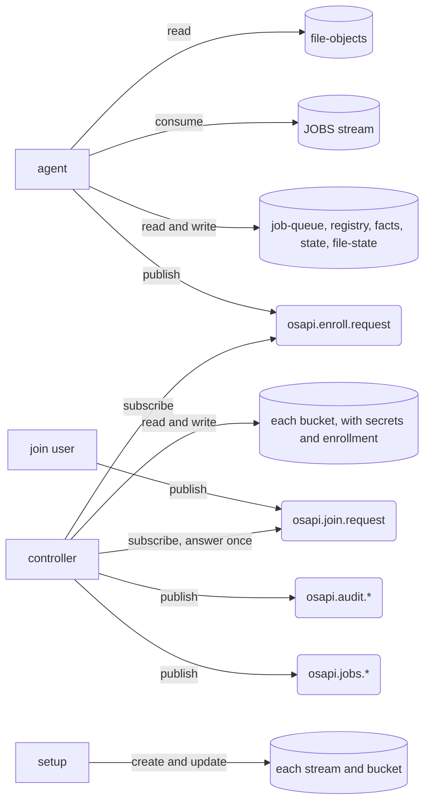

# Running osapi on your NATS

This page is for the NATS administrator: the person who runs the NATS
infrastructure that osapi uses. (In NATS, the operator is the root of the JWTs
in operator mode, so this page calls the person the administrator.) It tells
what osapi needs from a NATS server, what to provision for each kind of server,
and how a fleet whose hosts come and go connects.

You do not need this page when osapi runs its own embedded server
(`osapi nats start`, or `osapi start`). That server makes its streams and
buckets at start, and needs nothing from you.

## What osapi needs from a NATS server

- **JetStream.** osapi keeps its state in JetStream: the jobs and their results,
  the agent registry, the facts, the uploaded files, the secrets and the audit
  log. [State and storage](state.md) lists each stream and bucket, and its size
  settings. The object store of the uploaded files is 10 GiB by default
  (`nats.objects.max_bytes`).
- **A user for each process.** Each osapi process needs only the subjects of its
  role: the controller, an agent, or setup (`osapi nats setup`, and the embedded
  server's own connection). `osapi nats permissions get --role <role>` prints
  them for your config and namespace: the publish and subscribe lists, and the
  flags of `nsc add user` for operator mode. An agent cannot make or change a
  stream or a bucket. It opens the ones that `osapi nats setup` made.
- **A namespace.** Each subject, stream and bucket of osapi starts with its
  namespace, `osapi` by default. Two deployments, such as staging and
  production, share a server with two namespaces
  ([More than one deployment on one NATS](deployment.md#more-than-one-deployment-on-one-nats)).
- **Its streams and buckets.** `osapi nats setup` makes or updates each one to
  match the config, with the credentials of `controller.nats`. Run it one time,
  and again after a change to a stream or a bucket. A user that runs it needs
  the JetStream API to make streams, buckets and object stores: the setup role.
- **TLS, if the network is not yours.** `nats.server.tls` is the embedded
  server's. For your server, set `controller.nats.tls` and `agent.nats.tls`
  ([TLS](../usage/configuration.md)). Without TLS, a job's payload, a command's
  output and the facts cross the network in plain text; the controller still
  signs each job and verifies each answer.

## What each osapi process can use

Each osapi process connects as a NATS user with the role of the process. The
server lets the user use the subjects of its role, and nothing else. An agent
has no JetStream admin, cannot read the secrets or the enrollment records, and
cannot send a job. `osapi nats permissions get --role <role>` prints each set.



| Role         | Who connects as it                                 | It cannot                                            |
| ------------ | -------------------------------------------------- | ---------------------------------------------------- |
| `controller` | the controller, and the local controller commands  | make or delete the job stream                        |
| `agent`      | each agent                                         | make a stream or a bucket, send a job, read a secret |
| `setup`      | `osapi nats setup`, and the embedded server itself | write a job, a secret or a record                    |
| `join`       | an agent with a join string, before its join       | anything but the join request                        |

## What each kind of server needs

Each osapi process authenticates with its own `nats.auth`: `none`, `user_pass`,
`nkey` or `creds`.

osapi makes the credentials for you, one for each role, with the least
permissions of the role. Each secret goes to a file of mode 0600, and none is on
the command line:

```bash
osapi nats auth password create --out /etc/osapi/nats   # a user and a password per role
osapi nats auth operator create --out /etc/osapi/nats   # an operator, an account, creds per role
osapi nats auth nkey create --out /etc/osapi/nats       # an nkey per role
```

Each writes `osapi-nats.yaml`, the part of osapi.yaml that uses the files, to
merge into your config. `password create` also writes `nats-server.conf`, the
`authorization` block of a NATS server that osapi does not run.
`operator create` writes the resolver file of the server, a credentials file for
the setup, controller and agent roles, and `signing.nk`, the account signing key
that the controller mints the users of a join with. Keep `operator.nk`, the
operator's seed, offline. `--print` also prints the server's part.

In operator mode, a NATS server that osapi does not run needs
`max_control_line: 32KB`: a user JWT has the subjects of its role, and the
controller's is about 7 KB.

| Your NATS server      | What you provision                                                                                     | What each agent uses        |
| --------------------- | ------------------------------------------------------------------------------------------------------ | --------------------------- |
| Operator mode         | An account for osapi with JetStream on, and a user for the controller and for the agents (creds files) | `creds`: a credentials file |
| Static users or nkeys | A user or an nkey for the controller, and one for the agents                                           | `user_pass` or `nkey`       |
| No authentication     | Nothing. Use this only for development.                                                                | `none`                      |

The embedded server applies the roles itself: give each user of
`nats.server.auth.users` a `role`, and the server limits it to the subjects of
that role.

```yaml
nats:
  server:
    auth:
      type: user_pass
      users:
        - username: setup # the first user is the server's own connection
          password: ...
          role: setup
        - username: controller
          password: ...
          role: controller
        - username: agent
          password: ...
          role: agent
```

A user with no `role` can use each subject, as before.

The agents can share one user. A NATS user is not the identity of an agent: the
controller admits each agent by its own key, and verifies each answer that it
signs ([Agent identity](../features/platform/agent-identity.md)). Thus a shared
user does not let one agent answer for another.

## Revoking an agent in operator mode

In operator mode, an agent's NATS user is a JWT that the controller minted. With
`controller.join.agent_ttl`, such as `24h`, the JWT expires, and the agent
renews it over NATS when a third of its life is left. The controller renews only
a machine that is admitted, and only for a request that the machine's admitted
key signed. Thus `osapi client admission revoke` cuts an agent from NATS when
its JWT expires, also on a NATS server that osapi does not run.

Pick the TTL by how fast a revocation must take effect, and how long a host can
be off: an agent that is off for longer than the TTL cannot renew, and joins
again with a new join string. An empty `agent_ttl` gives a JWT that never
expires. Then osapi still refuses each answer and registration that a revoked
agent signs, but the agent stays on the bus.

The credentials that `osapi nats auth operator create` makes carry the subjects
of the version that made them. After an upgrade that adds a subject, such as the
renewal, make them again, or add the subject with `nsc edit user`.

## Hosts that come and go

You do not make a NATS user for each host. The agents share their user, so a
fleet that scales up and down needs nothing from you at each host. What each
host needs:

- **A machine ID of its own.** An agent's identity is `/etc/machine-id` on
  Linux. An image that ships a filled-in machine ID gives each clone the same
  identity, and a second clone replaces the first in admission. Ship the image
  with an empty `/etc/machine-id`, so that systemd makes one at the first boot.
- **Labels, not hostnames.** A host whose hostname is random is targeted by its
  labels, such as `--target role:web` with `agent.labels`.
- **Admission.** An agent asks to be admitted when it first starts, and an admin
  admits it ([Agent identity](../features/platform/agent-identity.md)). For
  hosts that come up on their own, an agent can join with a join token, which
  admits it at once.
- **Cleanup.** `controller.pki.delete_after`, such as `24h`, deletes a machine
  that has not reported for that time. Thus a host that went away leaves no
  record.

## Agents that join over NATS

A host needs only a join string
([Join with a token](../features/platform/agent-identity.md#join-with-a-token)).
The agent connects to NATS as the bootstrap user, which can only send the join
request. The controller admits it, and gives it its own NATS user. An agent then
needs to reach NATS, and nothing else, which fits a site behind a NATS leaf node
or a firewall that lets only NATS through.

What you provision depends on your server:

| Your NATS server   | What you give osapi                                                                                         | Built                                    |
| ------------------ | ----------------------------------------------------------------------------------------------------------- | ---------------------------------------- |
| osapi's own server | Users with the roles `join` and `agent` in `nats.server.auth.users`                                         | yes                                      |
| Static users       | A join user that can send only the join request, and an agent user, in `controller.join.user` and `.agent`  | yes                                      |
| Operator mode      | An account signing key, in `controller.join.signing_key_file` and `.account` (`operator create` makes them) | yes; a scoped key is osapi-io/osapi#1432 |
| Auth callout       | An `auth_callout` block that names osapi's issuer key (NATS 2.10 or later)                                  | planned (osapi-io/osapi#1416)            |

`osapi nats permissions get --role join` and `--role agent` print the subjects
of the two users.

With a scoped signing key, the operator's key stays with you: the template sets
the most that osapi can give an agent. The design is
[agent join](https://github.com/osapi-io/specs/blob/main/components/osapi/agent-join.md)
in the specs, and this page changes as each part is built.
