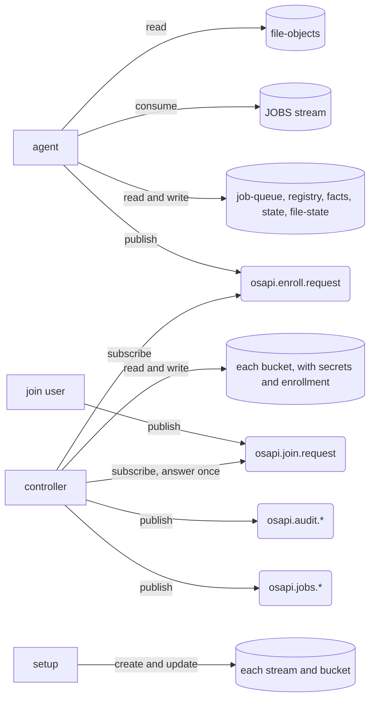

# NATS subjects and roles

osapi uses NATS for each message between its processes, and keeps its state in
JetStream. This page tells which subjects each process can use, and why.
[2. NATS](../operate/nats.md) tells how to set up a server.

## The roles

Each osapi process connects as a NATS user with the role of the process. The
server lets the user use the subjects of its role, and nothing else. An agent
has no JetStream admin, cannot read the secrets or the enrollment records, and
cannot send a job. `osapi nats permissions get --role <role>` prints each set.

| Role         | Who connects as it                                 | It cannot                                            |
| ------------ | -------------------------------------------------- | ---------------------------------------------------- |
| `controller` | the controller, and the local controller commands  | make or delete the job stream                        |
| `agent`      | each agent                                         | make a stream or a bucket, send a job, read a secret |
| `setup`      | `osapi nats setup`, and the embedded server itself | write a job, a secret or a record                    |
| `join`       | an agent with a join string, before its join       | anything but the join request                        |

## Why the join has its own user

A host that joins knows only its join string. Its bootstrap user can send the
join request, and nothing else. Thus a join string that leaks cannot read a job
or a secret. The controller admits the host by its token, and gives it its own
NATS user:

- **osapi's server and static users:** the agent user, which the agents share.
- **Operator mode:** a JWT for the agent's own key, signed with a scoped signing
  key. The template of the key holds the subjects of the agent role. Thus the
  controller cannot give an agent more than that role, also when the controller
  is not trusted.

- **Auth callout:** no user. The server asks the controller about each
  connection. The controller admits the agent's own NATS user key, which the
  agent sent at its join, and only while the machine is admitted.

A shared user does not let one agent answer for another. The controller admits
each agent by its own key, and checks the signature of each answer
([Agent identity](agent-identity.md)).

## How a revocation cuts an agent from NATS

In operator mode, the NATS server checks the JWT of an agent, not its admission.
Thus the controller tells the server when it removes a machine. A revocation, a
rejection or a delete of an admitted machine adds the agent's NATS user to the
revocations of osapi's account. The controller signs the account again with an
operator signing key, and sends it to the server as a user of the system
account. The server closes each connection of that user at once, and refuses
each JWT of the user from before the revocation.

The server keeps the account that it gets in memory only. Thus the controller
records each revocation in the enrollment bucket, and sends the account again
each minute while a revocation is left. A revocation older than
`controller.join.agent_ttl` is removed, because each JWT that it refuses has
expired. A machine that joins again gets a new NATS user, so the old revocation
does not stop it.

A setup with no `controller.join.revocation.account_jwt_file` file cuts a
revoked host only when its JWT expires. The controller renews a JWT only for a
host that is admitted. Thus `controller.join.agent_ttl` is then the longest time
that a revoked host stays on NATS. In each setup, osapi refuses each answer and
each registration that the revoked host signs.

## Design

[Agent join](https://github.com/osapi-io/specs/blob/main/components/osapi/agent-join.md)
in the specs has the design.
