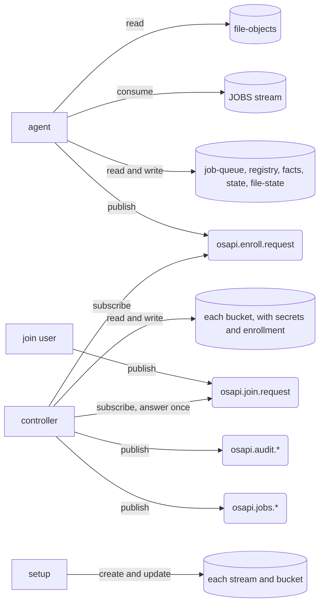

# NATS subjects and roles

osapi uses NATS for each message between its processes, and keeps its state in
JetStream. This page tells which subjects each process can use, and why.
[2. NATS](../operate/nats.md) tells how to set up a server.

## The roles

Each osapi process connects as a NATS user with the role of the process. The
server lets the user use the subjects of its role, and nothing else. An agent
has no JetStream admin, cannot read the secrets or the enrollment records, and
cannot send a job. `osapi nats permissions get --role <role>` prints each set.

| Role         | Who connects as it                                 | It cannot                                            |
| ------------ | -------------------------------------------------- | ---------------------------------------------------- |
| `controller` | the controller, and the local controller commands  | make or delete the job stream                        |
| `agent`      | each agent                                         | make a stream or a bucket, send a job, read a secret |
| `setup`      | `osapi nats setup`, and the embedded server itself | write a job, a secret or a record                    |
| `join`       | an agent with a join string, before its join       | anything but the join request                        |

## Why the join has its own user

A host that joins knows only its join string. Its bootstrap user can send the
join request, and nothing else. Thus a join string that leaks cannot read a job
or a secret. The controller admits the host by its token, and gives it its own
NATS user:

- **osapi's server and static users:** the agent user, which the agents share.
- **Operator mode:** a JWT for the agent's own key, signed with a scoped signing
  key. The template of the key holds the subjects of the agent role. Thus the
  controller cannot give an agent more than that role, also when the controller
  is not trusted.

A shared user does not let one agent answer for another. The controller admits
each agent by its own key, and checks the signature of each answer
([Agent identity](agent-identity.md)).

## Why a revocation can wait for a JWT

In operator mode, the NATS server checks the JWT of an agent, not its admission.
A revoked host keeps its connection until its JWT expires. The controller renews
a JWT only for a host that is admitted, for a request that the host's admitted
key signed. Thus `controller.join.agent_ttl` is the longest time that a revoked
host stays on NATS. Before that time, osapi refuses each answer and each
registration that the revoked host signs.

## Design

[Agent join](https://github.com/osapi-io/specs/blob/main/components/osapi/agent-join.md)
in the specs has the design.
