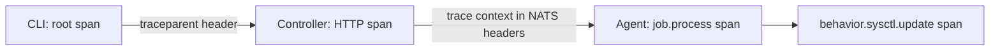

# Observability

Each of the three processes reports through the same four channels: traces,
metrics, logs and a heartbeat in the registry. One trace ID follows a request
from the command that sent it to the agent that ran it.

## Traces

osapi uses OpenTelemetry. A trace starts in the CLI and goes with the work:

1. The CLI starts a span and sends `traceparent` with the request.
1. The HTTP middleware of the controller continues the trace. The NATS client
   puts the trace context in the headers of the job notification.
1. The agent continues the trace in a `job.process` span. A method of a behavior
   adds a `behavior.<name>.<method>` span below it. That span has the behavior,
   the method, the result, whether the host changed, and the input fields that
   the behavior marks for traces.

Tracing is off by default (`telemetry.tracing`). If you turn it on without an
exporter, each log line has `trace_id` and `span_id`. Then one grep shows a
request from start to end. The `otlp` exporter sends spans over gRPC to a
backend, for example Jaeger or Tempo. The `stdout` exporter prints them.
`--debug` turns on tracing without an exporter.

## Metrics

Each process can run a metrics server on its own port. The server has
`/metrics` in the Prometheus format, and the `/health` and `/health/ready`
probes. The metrics server of the controller is on 9090 by default.
`agent.metrics` and `nats.server.metrics` set the servers of the agent and the
NATS server. osapi records metrics through OpenTelemetry and exports them with
the `osapi_` prefix, together with the Go runtime and process metrics. Watch
these metrics first:

| Metric                            | From       | Watch for                                 |
| --------------------------------- | ---------- | ----------------------------------------- |
| `osapi_component_up`              | All        | 0: the process is not ready               |
| `osapi_subsystem_up`              | All        | 0 on a subsystem, for example the notifier |
| `osapi_jobs_created_total`        | Controller | The request rate                          |
| `osapi_jobs_processed_total`      | Agent      | The `failed` part, by status              |
| `osapi_job_duration_seconds`      | Agent      | Slow operations                           |
| `osapi_heartbeat_age_seconds`     | Agent      | An increase: the agent cannot reach NATS  |
| `osapi_behavior_calls_total`      | Agent      | Calls for each behavior, method and result |
| `osapi_behavior_duration_seconds` | Agent      | The latency of each method                |
| `osapi_behavior_changes_total`    | Agent      | How often a write changed a host          |

[Metrics](../features/metrics.md) lists each metric and its labels.

## Logs

Each process writes logs with the structured logger of Go, one line for each
event. Each line names its subsystem, for example `agent.heartbeat`,
`controller.api` or `provider.sysctl`. All lines use the same field names:
`hostname`, `job_id`, `path` and `error`. With tracing on, each line also has
the trace ID and the span ID.

Debug lines show each operation that the agent dispatches, and each change that
it skips because the host already has the state. Warnings show a state that is
not normal but still operates. An operation that fails, for example a sysctl
write that the kernel did not apply, is an error and fails the job.

## Health and the registry

Each component writes a heartbeat to the registry every 10 seconds. The
heartbeat gives the state of each part of the component:

- the API, the metrics, the notifier and tracing of the controller
- the heartbeat and the metrics of the agent
- the NATS server

If a component does not write its entry again in `nats.registry.ttl`, the entry
expires, and osapi shows the component as unreachable.

| Endpoint             | Tells                                               | Token needed  |
| -------------------- | --------------------------------------------------- | ------------- |
| `/api/health`        | The controller process runs                         | No            |
| `/api/health/ready`  | The controller can reach NATS and its KV buckets    | No            |
| `/api/health/status` | Each component and its parts, on all hosts          | `health:read` |

`osapi client health status` shows the last endpoint.
`osapi client agent list` shows each agent with its conditions.

## Conditions and notifications

Each component examines its conditions at each heartbeat, for example memory,
disk and load pressure on an agent. It compares them with the limits in
`agent.conditions`, and writes them with the heartbeat.

The controller watches the registry. It makes a notification when a condition
starts (fired) or stops (resolved), or when the heartbeat of a component expires
(unreachable). It sends the notification of an active condition again at an
interval, so that the notification stays visible. Today, notifications go to
the log.

You can also drain an agent. A drained agent does not receive new work, but the
process continues to run. The drain and its timeline stay in the agent state
bucket.

## Design details

- [Observability in the specifications](https://github.com/osapi-io/specs/blob/main/components/osapi/observability.md)
- [Distributed tracing](../features/distributed-tracing.md),
  [Metrics](../features/metrics.md),
  [Health checks](../features/health-checks.md),
  [Notifications](../features/notifications.md) and
  [Agent lifecycle](../features/agent-lifecycle.md) tell how to configure each
  one.
