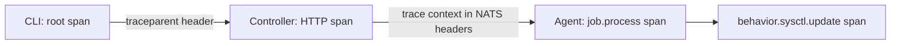

# Observability

Each of the three processes reports through the same four channels: traces,
metrics, logs and a heartbeat into the registry. A request can be followed from
the command that sent it to the agent that ran it, by one trace ID.

## Traces

osapi uses OpenTelemetry. A trace starts in the CLI and travels with the work:

1. The CLI starts a span and sends `traceparent` with the request.
2. The controller continues it in its HTTP middleware, and the NATS client
   carries the context in the headers of the job notification.
3. The agent continues it in a `job.process` span. A behavior's method adds a
   `behavior.<name>.<method>` span under that, with the behavior, the method,
   the outcome, whether it changed the host, and the input fields the behavior
   marks for tracing.

Tracing is off by default (`telemetry.tracing`). Turned on with no exporter,
every log line carries `trace_id` and `span_id`, so one grep shows a request end
to end. The `otlp` exporter sends spans over gRPC to a backend such as Jaeger or
Tempo, and `stdout` prints them raw. `--debug` turns on tracing without an
exporter.

## Metrics

Each process can run a metrics server on its own port, with `/metrics` in the
Prometheus format and the `/health` and `/health/ready` probes beside it. The
controller's is on 9090 by default; the agent's and the NATS server's are set by
`agent.metrics` and `nats.server.metrics`. Metrics are recorded through
OpenTelemetry and exported with the `osapi_` prefix, alongside the Go runtime
and process metrics. The ones to watch first:

| Metric                            | From       | Watch for                                 |
| --------------------------------- | ---------- | ----------------------------------------- |
| `osapi_component_up`              | All        | 0: the process is not ready               |
| `osapi_subsystem_up`              | All        | 0 on a subsystem, such as the notifier    |
| `osapi_jobs_created_total`        | Controller | Request rate                              |
| `osapi_jobs_processed_total`      | Agent      | The `failed` share, by status             |
| `osapi_job_duration_seconds`      | Agent      | Slow operations                           |
| `osapi_heartbeat_age_seconds`     | Agent      | Rising: the agent cannot reach NATS       |
| `osapi_behavior_calls_total`      | Agent      | Calls per behavior, method and outcome    |
| `osapi_behavior_duration_seconds` | Agent      | Per-method latency                        |
| `osapi_behavior_changes_total`    | Agent      | How often a write actually changed a host |

[Metrics](../features/metrics.md) lists every metric and its labels.

## Logs

Every process logs with Go's structured logger, one line per event. Each line
names its subsystem, such as `agent.heartbeat`, `controller.api` or
`provider.sysctl`, and uses the same field names everywhere: `hostname`,
`job_id`, `path`, `error`. With tracing on, each line also carries the trace and
span IDs. Debug lines show each operation dispatched and each change skipped
because the host already had it; warnings mark a degraded but working state,
such as a reload that failed after a file was written.

## Health and the registry

Every component writes a heartbeat to the registry every 10 seconds, listing the
state of its parts: the controller's API, metrics, notifier and tracing, the
agent's heartbeat and metrics, and the NATS server's. An entry that is not
refreshed within `nats.registry.ttl` expires, and the component is unreachable.

| Endpoint             | Answers                                          | Token needed  |
| -------------------- | ------------------------------------------------ | ------------- |
| `/api/health`        | The controller process is up                     | No            |
| `/api/health/ready`  | The controller can reach NATS and its KV buckets | No            |
| `/api/health/status` | Every component and its parts, across every host | `health:read` |

`osapi client health status` shows the last one, and `osapi client agent list`
shows each agent with its conditions.

## Conditions and notifications

Each component evaluates conditions on every heartbeat, such as memory, disk and
load pressure on an agent, against thresholds in `agent.conditions`, and writes
them with the heartbeat. The controller watches the registry and turns a
condition that starts, stops, or a component whose heartbeat expired into a
notification: fired, resolved or unreachable. An active condition is notified
again at an interval, so it does not scroll away. Notifications go to the log
today. An agent can also be drained, which stops it taking new work without
stopping the process; the drain and its timeline persist in the agent state
bucket.

## Design details

- [Observability in the specifications](https://github.com/osapi-io/specs/blob/main/components/osapi/observability.md)
- [Distributed tracing](../features/distributed-tracing.md),
  [Metrics](../features/metrics.md),
  [Health checks](../features/health-checks.md),
  [Notifications](../features/notifications.md) and
  [Agent lifecycle](../features/agent-lifecycle.md), for configuring each.
