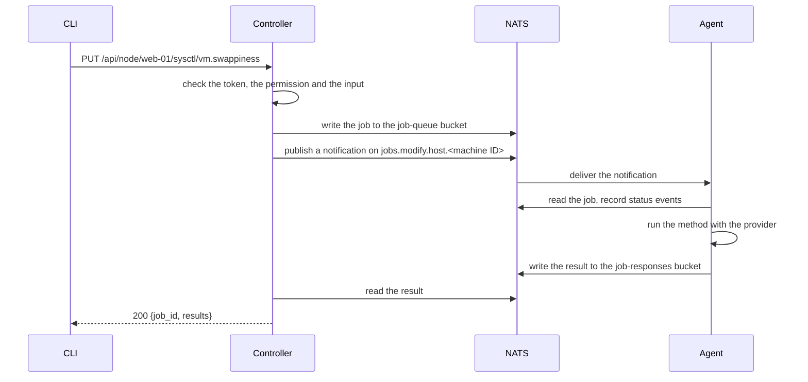

# How a request runs

Every change and every read of a host is a job. A client never addresses an
agent directly: it asks the controller, which queues a job for the agents the
request targets and waits for their results.



## Before a job is queued

The controller refuses a request before any job exists when:

- the token is missing or invalid (401), or does not grant the operation's
  permission (403). Each operation needs one permission, such as `sysctl:write`;
  [Security](security.md) has how a token gets them;
- the target is not a known agent, label, `_any` or `_all` (400);
- the input breaks a rule, such as a missing field or a key that is not a kernel
  parameter name (400).

A refused request leaves no job, and an audit entry if it carried a valid token.

## Targeting

`--target` on the CLI, or the `{hostname}` in the route, decides which agents
get the job:

| Target          | Reaches                                                        |
| --------------- | -------------------------------------------------------------- |
| `web-01`        | That agent, by hostname or machine ID                          |
| `_any`          | One agent, whichever is free; the agents share a queue group   |
| `_all`          | Every agent                                                    |
| `group:web.dev` | Every agent whose `group` label is `web.dev` or starts with it |

The controller resolves a hostname to the agent's machine ID before publishing,
so an agent whose hostname changes keeps getting its work. Labels are
dot-separated, and an agent subscribes to every prefix of each label: one with
`group: web.dev.us-east` gets work for `group:web`, `group:web.dev` and
`group:web.dev.us-east`. An agent may have up to five labels; each prefix of
each label is a JetStream consumer, so a large fleet with many labels belongs on
an external NATS cluster.

## The job

The job itself is written to a KV bucket and stays there; the stream carries
only a notification that points at it. Reads and changes travel on separate
subjects, `jobs.query.*` and `jobs.modify.*`, so an agent can treat them
differently. When PKI is on, the controller signs the job and the agent checks
the signature before running it.

The agent records each step as a status event on the job, runs the operation,
and writes its result to the response bucket. A job's status is worked out from
those events and responses when it is read, not stored:

| Status         | Means                                                           |
| -------------- | --------------------------------------------------------------- |
| `submitted`    | The controller queued it                                        |
| `acknowledged` | An agent received it                                            |
| `started`      | The agent is running it                                         |
| `completed`    | It ran and succeeded                                            |
| `failed`       | It ran and did not succeed                                      |
| `skipped`      | The host cannot do it, such as a Debian-only operation on macOS |
| `timeout`      | No answer within `controller.api.job_timeout`                   |

`timeout` is not `failed`: it says nothing about whether the operation ran. The
agent may be gone, or still working and about to answer. A job that broadcast to
several agents also reports `processing` while some are still running and
`partial_failure` when some failed.

An agent that takes a job and does not acknowledge it gets it again, up to
`agent.consumer.max_deliver` times. After that the job's delivery advisory goes
to the dead-letter stream, `JOBS-DLQ`, where it can be inspected.

## The result

The controller waits for the result and returns it on the same request, with the
job's ID:

```json
{
  "job_id": "550e8400-e29b-41d4-a716-446655440000",
  "results": [
    {
      "hostname": "web-01",
      "status": "ok",
      "key": "vm.swappiness",
      "changed": true
    }
  ]
}
```

Every result is a list with one row per host, whether one host answered or a
hundred. Each row carries the host's name and its status: `ok`, `failed`,
`skipped` or `timeout`, with `error` for the last three. A change reports
`changed`, which is false when the host already had what was asked, so running
the same request twice changes nothing the second time.

A broadcast waits for every agent it expects. One that does not answer within
the timeout gets a `timeout` row, so the response always says what happened on
every host it meant to reach.

## Jobs after the fact

The job and its results stay in NATS after the request returns, for
`nats.kv.ttl`:

```bash
osapi client job list --status failed
osapi client job get --id <job_id>
osapi client job retry --id <job_id>
osapi client job delete --id <job_id>
```

There is no command that creates a job directly. Each operation's own endpoint
and command creates its job, with the input checked for that operation.

## Design details

- [The job system](https://github.com/osapi-io/specs/blob/main/components/osapi/job-system.md):
  subjects, the KV-first design, statuses, retries and broadcast.
- [Permissions](https://github.com/osapi-io/specs/blob/main/components/osapi/permissions.md):
  how an operation's permission is chosen.
