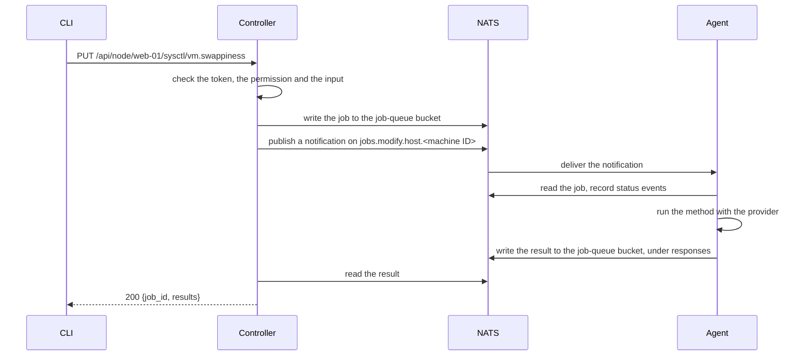

# How a request runs

Each change and each read of a host is a job. A client does not send a request
to an agent. It sends the request to the controller. The controller puts a job
on the queue for the agents that the request targets, and waits for their
results.



## Before a job is queued

The controller refuses a request before it makes a job in these cases:

- The token is missing or not valid (401).
- The token does not give the permission of the operation (403). Each operation
  needs one permission, for example `sysctl:write`. [Security](security.md)
  tells how a token gets permissions.
- The target is not a known agent, a label, `_any` or `_all` (400).
- The input breaks a rule, for example a missing field or a key that is not the
  name of a kernel parameter (400).

A refused request makes no job. If it had a valid token, it makes an audit
entry.

## Targeting

`--target` on the CLI, or `{hostname}` in the route, selects the agents that
receive the job:

| Target          | Sends the job to                                              |
| --------------- | ------------------------------------------------------------- |
| `web-01`        | That agent, by hostname or machine ID                         |
| `_any`          | One agent that is free. The agents share a queue group        |
| `_all`          | All agents                                                    |
| `group:web.dev` | Each agent whose `group` label is `web.dev` or starts with it |

The controller changes a hostname to the machine ID of the agent before it
publishes. Thus an agent continues to receive its work when its hostname
changes.

A label has parts with dots between them. An agent subscribes to each prefix of
each label. For example, an agent with `group: web.dev.us-east` receives work
for `group:web`, `group:web.dev` and `group:web.dev.us-east`. An agent can have
up to five labels. Each prefix of each label is a JetStream consumer. Thus a
large fleet with many labels needs an external NATS cluster.

Each consumer is durable, and its name has the machine ID of the agent. NATS
removes a consumer that has no fetch for `agent.consumer.inactive_threshold`, 24
hours by default. Thus a host that gets a new machine ID, such as a rebuilt VM,
does not keep its old consumers in the stream. An agent that starts again in
that time continues with the same consumers. The agent sets the threshold each
time it starts, so a consumer that had no threshold gets it.

A new consumer gets only the jobs that come after NATS makes it. Thus a new host
or a new label does not run the jobs that the stream kept from before. An agent
that starts again with the same consumers gets the jobs that came while it was
gone. Keep the threshold at or above `nats.stream.max_age`. Then the consumer of
an agent that was gone stays while the stream keeps a job for it.

NATS does not change the deliver policy of a consumer that exists. When the
agent finds a consumer with a different deliver policy, such as one that an
earlier version made, it removes the consumer, makes it again and logs a
warning. Thus an upgraded agent gets its consumers with no operator action.

If the agent cannot make or bind a consumer, for example when the stream has its
maximum number of consumers, it reports the `ConsumersUnavailable` condition and
tries again each 10 seconds. Refer to
[Agent lifecycle](agent-lifecycle.md#node-conditions).

## The job

The controller writes the job to a KV bucket, and the job stays there. The
stream carries only a notification that points to the job. Reads and changes go
on different subjects, `jobs.query.*` and `jobs.modify.*`. Thus an agent can
process them differently. The controller signs the job. The agent checks the
signature before it runs the job.

The agent records each step as a status event on the job. Then it runs the
operation and writes its result to the response bucket. osapi does not store the
status of a job. It calculates the status from the events and the responses when
you read the job:

| Status         | Meaning                                                             |
| -------------- | ------------------------------------------------------------------- |
| `submitted`    | The controller put the job on the queue                             |
| `acknowledged` | An agent received the job                                           |
| `started`      | The agent runs the job                                              |
| `completed`    | The job ran and succeeded                                           |
| `failed`       | The job ran and did not succeed                                     |
| `skipped`      | The host cannot do the job, for example a Debian operation on macOS |
| `timeout`      | No answer in `controller.api.job_timeout`                           |
| `refused`      | The controller refused the result: the admitted key did not sign it |

`refused` is the controller's event, not the agent's. It outranks what the agent
reported, and the job counts it as failed. The agent then shows `Refused` with
the `KeyMismatch` condition in `osapi client agent list`.

`timeout` is not `failed`. It does not tell if the operation ran. The agent can
be gone, or it can still do the work and answer soon. A job sent to many agents
also reports `processing` while some agents still run it, and `partial_failure`
when some agents failed.

If an agent receives a job and does not acknowledge it, the agent receives the
job again, up to `agent.consumer.max_deliver` times. After that, the delivery
advisory of the job goes to the dead-letter stream, `JOBS-DLQ`. You can examine
it there.

## The result

The controller waits for the result. It returns the result, with the ID of the
job, on the same request:

```json
{
  "job_id": "550e8400-e29b-41d4-a716-446655440000",
  "results": [
    {
      "hostname": "web-01",
      "status": "ok",
      "key": "vm.swappiness",
      "changed": true
    }
  ]
}
```

Each result is a list with one row for each host, for one host or for one
hundred. Each row has the name of the host and its status: `ok`, `failed`,
`skipped` or `timeout`. The last three also have `error`. A change reports
`changed`. It is false when the host already had the requested state. Thus the
same request, when you run it a second time, changes nothing.

A broadcast waits for each agent that it expects. If an agent does not answer in
the timeout, the result gets a `timeout` row for it. Thus the response always
tells what happened on each host that the request targeted.

## Jobs after the request

The job and its results stay in NATS after the request returns, for
`nats.kv.ttl`:

```bash
osapi client job list --status failed
osapi client job get --id <job_id>
osapi client job retry --id <job_id>
osapi client job delete --id <job_id>
```

No command makes a job directly. The endpoint and the command of each operation
make its job, and they check the input for that operation.

## Design details

- [The job system](https://github.com/osapi-io/specs/blob/main/components/osapi/job-system.md):
  the subjects, the KV-first design, the statuses, the retries and broadcast.
- [Permissions](https://github.com/osapi-io/specs/blob/main/components/osapi/permissions.md):
  how osapi selects the permission of an operation.
