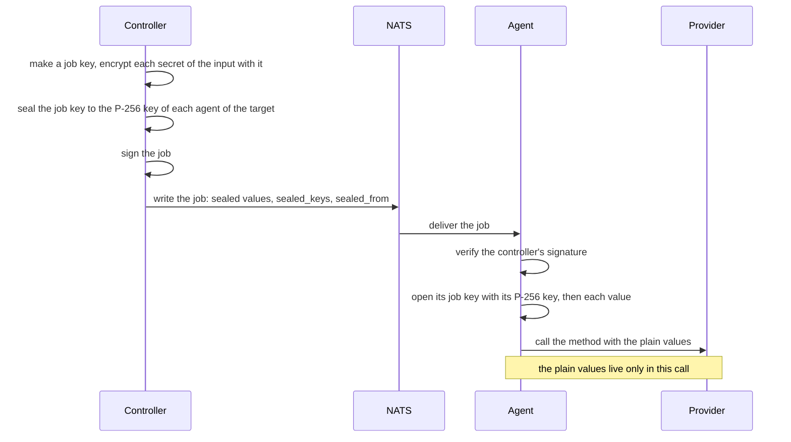

# Secrets

A secret is a value that only the hosts that use it can read, such as an API
token or a private key. This page tells how osapi keeps a secret now.

## What osapi has now

Each kind of secret has its own solution:

- The JWT signing keys and the NATS passwords are values in `osapi.yaml` or in
  an environment variable. `osapi config list` and `osapi config get` print them
  as `********`.
- The PKI keys are files in `key_dir`.
- A behavior input that is a secret, such as a password or the environment of a
  container, stays out of the audit log, the spans and the chain records.

## A secret is a type

An input field that holds a secret has the type `secret.Value` of
`internal/secret`, in the behavior, endpoint and command DSLs. A map of secrets
is `map[string]secret.Value`. No tag makes a secret. A tag with a typo makes an
ordinary field, and nothing reports it. A type cannot have a typo.

A `secret.Value` holds a reference, `secret://<vault>/<key>`, or a value. Its
`String`, `Format`, `MarshalJSON` and `LogValue` give the reference, or
`[redacted]` for a value. Only `Reveal` gives the value. The DSLs do these
things with the type:

- The spec makes it a string of format `password`, `writeOnly`, with
  `x-osapi-secret: true`. Its description tells what it takes.
- The audit redacts each field of the type by name, and keeps a reference.
- A span never records it, and a chain record has the reference or `[redacted]`.
- The CLI flag takes a reference, or `-` to read the value from standard input.
  It refuses a value.
- `validate` refuses one with `telemetry:"attr"`, one in the path or the query
  of a route, and a chain that gives one to a field of a different type.
- `TestSecretsAreTyped` fails a `string` input field whose name is on the audit
  denylist.

The CLI sends the request, and the controller queues the job, with
`secret.Plain`, which gives each value.

## A reference on the controller

`Serve` in `internal/controller/endpoint/server` resolves each reference of the
input before it calls the handler. Thus each method of the behavior DSL and the
endpoint DSL does it, with no code in the method. `secrets.go` does these steps,
in this order:

1. Each reference has the form `secret://<vault>/<key>`, a key that a vault
   takes, and a vault of `controller.secrets.vaults`. If not, the request
   gets 400.
2. The limits of use. The token has `secret:use`, and the host of the route is
   in the `targets` of each vault that has targets. If not, the request
   gets 403. A route with no host, such as a method that runs on the controller,
   gets no secret from a vault with targets. The middleware already refused a
   host outside the target scope of the token.
3. `secret.Resolve` reads each value from its vault, and puts it in place of the
   reference. A key that the vault does not have gives 400. A vault that does
   not answer gives 500, and the controller logs the cause.
4. `Valid` checks the input again, so a value obeys the `validate` tags of its
   field, such as `no_linebreak`.

The limits come before the read. Thus a caller without `secret:use` does not
learn if a key exists, and the controller reads no value that it does not use.
Each refusal gives the reference, never the value. The middleware puts the
resolved permissions of the token in the context with
`authtoken.WithPermissions`, and `authtoken.Granted` reads them.

The handler then gets the value. A `.Before` step runs on it, and the job gets
what the step leaves, sealed. The audit entry keeps the reference, because it
records the body of the request. A chain record of the agent has `[redacted]`,
because the dispatch gives the provider the value.

## A sealed job

The input of a behavior is the data of its job, and JetStream and the job KV
keep that data. Thus the job client seals each secret of the data before it
stores the job (`request` in `internal/job/client`, and `internal/secret/seal`):

1. It makes a new random 256-bit job key, and encrypts each `secret.Value` that
   is not empty with it, with AES-256-GCM and a new random 12-byte nonce for
   each value. The job ID is the additional data, so a value that somebody
   copies to a different job does not open. `secret.PlainFunc` writes each value
   as `sealed:` and base64url of the nonce, the ciphertext and the tag.
2. It makes a new P-256 key for the job, and seals the job key to the P-256 key
   of each agent that the target can reach. `job.Recipients` gives the agents:
   each agent that takes jobs for `_all`, `_any` or a label, and the agent of
   one host. The admission store gives the P-256 key of each agent.
3. The operation of the job has `sealed_keys`, a map from machine ID to the
   sealed job key, and `sealed_from`, the public P-256 key that sealed them. The
   controller signs the job as before, so an agent knows that the controller
   sealed it.

### The wire format

Each algorithm of the seal is a FIPS 140-3 approved algorithm, from the Go
standard library: ECDH on P-256 (`crypto/ecdh`), HKDF-SHA256 (`crypto/hkdf`) and
AES-256-GCM (`crypto/aes`, `crypto/cipher`). The seal has one construction, and
no other algorithm. Each text below is base64url with no padding.

| Item                 | Form                                                                                                                                                                                                                   |
| -------------------- | ---------------------------------------------------------------------------------------------------------------------------------------------------------------------------------------------------------------------- |
| A public key         | The 65 bytes of the uncompressed P-256 point.                                                                                                                                                                          |
| `sealed_from`        | The public key of the P-256 key that the controller makes for the job.                                                                                                                                                 |
| A key-encryption key | HKDF-SHA256 of the ECDH secret of `sealed_from` and the key of the agent. It has no salt. Its info is `osapi-seal-v1`, then the 65 bytes of `sealed_from`, then the 65 bytes of the key of the agent. It has 32 bytes. |
| A sealed job key     | The 12-byte nonce, then the 32-byte job key that AES-256-GCM encrypts with the key-encryption key, then the 16-byte tag. The job ID is the additional data.                                                            |
| A sealed value       | `sealed:`, then the 12-byte nonce, the value that AES-256-GCM encrypts with the job key, and the 16-byte tag. The job ID is the additional data.                                                                       |

Each nonce is random, from `cipher.NewGCMWithRandomNonce`. FIPS 140-3 only mode
refuses a GCM nonce that the caller selects. The agent refuses a sealed key or a
sealed value that is too short, that somebody changed, that is for a different
job, or that was sealed to a different key.

The agent opens its own job key with its P-256 key when it takes the job
(`openJob` in `internal/agent`). The dispatch of a behavior decodes the input
into the type of the method, opens each `secret.Value` with `secret.Map`, and
gives the provider the input. The values live only in that call.

An agent with no key in `sealed_keys` fails the job with
`seal.ErrNotSealedToAgent`, "the job was not sealed to this agent", and does not
run it. Such an agent joined after the controller queued the job, or has no
P-256 key.

The controller always has the P-256 key of each admitted agent, because PKI is
always on. A job client with no agent keys, such as the one of an agent, refuses
a job with a secret with `client.ErrNoAgentKeys`. Thus no secret goes in a job
as plain text.

A `.Before` step can still change a secret to a value made from it, such as a
password to its hash. A secret that the step leaves set is sealed, not refused.

## The store on the disk

The embedded NATS server encrypts each stream and bucket in its `store_dir` when
`nats.server.jetstream.key_file` names a key.
`osapi pki key create --name jetstream` makes the key on the NATS host. Thus a
person who reads the disk or a backup of the store does not read the jobs, the
audit log or the agent registry. The key does not protect a value from a NATS
user, because the server decrypts each message for a user that can read the
stream. [Encryption at rest](../operate/nats.md#osapis-nats) has the setting,
and what happens when the key is lost.

## The JWT signing keys

`controller.api.security.signing_keys` is a list of keys, each with an `id` and
a `key`. The first key signs each new token, and puts its `id` in the `kid`
header of the token. Each key verifies the tokens with its `id`. The controller
refuses a token with no `kid`, or with a `kid` that the list does not have.

Thus a signing key changes with no outage. Put a new key first, and restart the
controller. The tokens of the old key still work. Remove the old key when no
client sends a token that it signed. A token expires after three months.
[Authentication](../operate/secure/authentication.md#change-the-signing-key) has
the steps.

## Vaults

A vault is a store of secrets on the controller, with a name and a type.
`controller.secrets.vaults` names each vault. The controller opens each one when
it starts, and does not start when it cannot open one, such as when its key is
not there.

`internal/secret/vault` has the `Vault` interface (`Name`, `Get`, `Put`,
`Delete` and `List`) and a registry of types. A type registers its name, a
constructor and the Go struct of its `config` block. `osapi config validate`
checks each block against the struct of its type, and the struct gives the
settings in the config table. Thus a different store is a type that plugs in.

osapi has one type, `nats`, in `internal/secret/vault/natsvault`:

- It encrypts each value with AES-256-GCM under the vault key, with a new nonce
  each time. The vault and the key of the value are the additional data, so a
  value that somebody copies to a different key does not decrypt.
- It keeps each value in the KV bucket of `nats.secrets`, `osapi-secrets` with
  the namespace `osapi`, under `<vault>.<key>`. The bucket keeps the earlier
  versions of a key, as `nats.secrets.history` sets.
- The record of a value has its version, when it changed and who changed it, as
  plain text. A NATS user that reads the bucket sees these, and not the value.
- The vault key comes from `key_file` or `key_env`. The vault reads it at each
  call, so a rotation applies with no restart.

`osapi pki key create --name vault:<name>` writes a key, and
`osapi pki key rotate --name vault:<name>` adds a new key, encrypts each value
again and removes the old key. A rotation does not encrypt the earlier versions
in the history again, so they do not decrypt after it.
[Configuration](../operate/controller.md#secrets-vault) has the settings.

## References in the config

A secret field of the config, with the tag `mask:"password"`, takes a reference,
`secret://<vault>/<key>`. `internal/config/references.go` walks the config for
them:

- `osapi config validate` refuses a reference that does not parse, one that
  names a vault that `controller.secrets.vaults` does not have, and one in a
  field with the tag `noref`. A NATS password has `noref`, because osapi needs
  it to connect to NATS before it can read a vault. The rule of the key, such as
  `signing_key`, applies to the value, not to the reference.
- `config.ResolveReferences` puts the value of each reference under a key prefix
  in its place, and checks it against the rule of its key. The controller
  resolves `controller.api` after it opens its vaults. A command resolves the
  values that it reads, with `controller.OpenVaults` on a NATS connection of
  `controller.nats`: the signing keys for `osapi controller token`, and the
  bearer token for `osapi client`.
- The vault key cannot be a reference. The config refuses a reference in
  `key_file`, and the `nats` type refuses a key line that is a reference.

## What comes next

The `secret` commands and values sealed to the agent that uses them are in
progress, in [osapi #1065](https://github.com/osapi-io/osapi/issues/1065). This
page tells each part when it is built.
