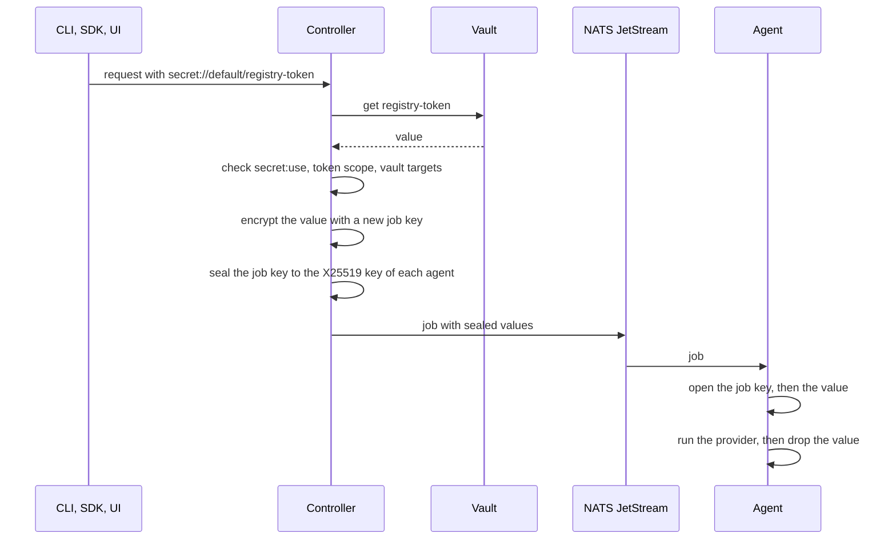

# Secrets

A secret is a value that only the hosts that use it can read, such as an API
token or a private key. This page tells how osapi keeps a secret, who can use
it, and how its value gets to an agent.

:::caution Planned

The secrets design is not built. This page tells the plan of
[osapi #1065](https://github.com/osapi-io/osapi/issues/1065). The commands, the
settings and the permissions on this page do not exist in a release yet. Each
part has its own issue, in the table below.

:::

## What osapi has now

Each kind of secret has its own solution:

- The JWT signing key and the NATS passwords are values in `osapi.yaml` or in an
  environment variable. The controller masks them before it logs its config.
- The PKI keys are files in `key_dir`.
- A behavior input tagged `secret:"true"` stays out of the audit log, the spans
  and the chain records.

The tag does not keep a value out of NATS. The input of a behavior is the data
of its job, and JetStream keeps that data. Thus a token in the environment of a
container is plain text in JetStream now. The design on this page removes this
problem.

## The status of each part

| Part                                                              | Status  | Issue                                                  |
| ----------------------------------------------------------------- | ------- | ------------------------------------------------------ |
| The `secret.Value` type, in place of the `secret` tag             | Planned | [#1240](https://github.com/osapi-io/osapi/issues/1240) |
| The `Vault` interface, the `nats` vault and `controller.secrets`  | Planned | [#1241](https://github.com/osapi-io/osapi/issues/1241) |
| JetStream encryption at rest                                      | Planned | [#1242](https://github.com/osapi-io/osapi/issues/1242) |
| The `secret` endpoint group, its permissions and the Secrets page | Planned | [#1243](https://github.com/osapi-io/osapi/issues/1243) |
| The controller resolves references and checks who may use them    | Planned | [#1244](https://github.com/osapi-io/osapi/issues/1244) |
| `secret://` references in the config                              | Planned | [#1245](https://github.com/osapi-io/osapi/issues/1245) |
| An X25519 key for each agent at enrollment                        | Planned | [#1246](https://github.com/osapi-io/osapi/issues/1246) |
| Sealed values in the job, opened by the agent                     | Planned | [#1247](https://github.com/osapi-io/osapi/issues/1247) |
| The reference picker of the UI, and the rule in the skill         | Planned | [#1248](https://github.com/osapi-io/osapi/issues/1248) |
| More than one JWT signing key                                     | Planned | [#1249](https://github.com/osapi-io/osapi/issues/1249) |
| Vault types from extensions                                       | Planned | [#1250](https://github.com/osapi-io/osapi/issues/1250) |

## One reference

A request names a secret with a reference. It does not send the value:

```
secret://<vault>/<key>
```

`secret://default/registry-token` is the key `registry-token` in the vault
`default`. A behavior input, an endpoint input, a command flag, a config value
and a step of a plan all use this form.

The controller resolves a reference. The agent does not, because the agent has
no vault and no credentials for one. The API never returns the value of a
secret. It returns names, and the metadata of a key.

## Vaults

A vault keeps secrets. Each vault has a name, a type and, if you want, a list of
targets. The config names each vault in `controller.secrets.vaults`. A reference
names the vault, not its type. Thus you can move the keys of a vault to a
different type, and each reference continues to resolve.

osapi has one vault type, `nats`. It keeps each value in the JetStream KV bucket
`osapi-secrets`:

- It encrypts each value with AES-256-GCM under the vault key. The bucket keeps
  only the encrypted value and its metadata.
- The bucket keeps the earlier versions of a key.
- The vault key is in `key_file`, or in an environment variable that the config
  names.

osapi also turns on JetStream encryption at rest, with a different key. That key
protects each stream and bucket on the disk. It does not protect a value from a
NATS user, so the vault also encrypts each value.

A different store, such as HashiCorp Vault, 1Password or a cloud secret manager,
is a vault type that an extension adds. Extensions are planned in
[osapi #1064](https://github.com/osapi-io/osapi/issues/1064).

## Who may use a secret

A caller that can put a secret into a file or an environment on a host can read
it there. Thus to use a reference needs its own permission. Three limits apply
to each reference in a request, and all three must pass:

- **The permission `secret:use`.** The roles `admin` and `automation` have it.
  `operator`, `read`, `auditor` and `observer` do not have it.
- **The target scope of the token.** It limits the hosts, as it does for each
  request.
- **The targets of the vault.** A vault can name the hosts that its secrets go
  to, such as `group:prod`. The controller does not seal a secret of that vault
  for an agent outside them. A vault with no targets goes to each host.

The audit entry of the request records each reference that the request used. It
does not record a value.

## How a value gets to an agent

The controller resolves each reference and checks the three limits. Then it
seals each value for the agents that the target names. NATS keeps only sealed
values.



1. The controller makes a new random key for the job. It encrypts each secret
   value of the job with this key (XChaCha20-Poly1305).
1. It seals the job key to the X25519 key of each target agent. The agent makes
   this key at enrollment, next to its Ed25519 signing key.
1. The job has each secret field in its sealed form, and one sealed job key for
   each agent. JetStream, the job KV and the audit log never see the plain
   value.
1. The agent opens the job key with its own X25519 key, and then opens each
   value. It gives the values to the provider, and drops them when the provider
   returns.

An agent that joins after the controller queues the job has no sealed key in the
job. It does not run the job, and reports it as failed.

## Secrets in a chain

A parent behavior calls its children on the agent, in the same job. Thus a
secret input of a parent goes to a child as each other input does. For example,
`certificate.create` gives a private key to `managedfile.update` as the content
of a file. The controller seals the key one time, for the top method. The agent
opens it one time. The chain records show the reference, not the value.

`osapi dsl behavior validate` checks the type across a chain. A parent that
gives a secret to a child input that is not a secret fails the check. Thus a
chain cannot change a secret into an ordinary string.

## Commands

The commands that set and read secrets go through the API. Thus each call has a
permission check and an audit entry:

| Command                          | Permission     | What it does                                 |
| -------------------------------- | -------------- | -------------------------------------------- |
| `osapi client secret vault list` | `secret:read`  | Lists each vault, with its type and targets  |
| `osapi client secret list`       | `secret:read`  | Lists the keys of a vault                    |
| `osapi client secret get`        | `secret:read`  | Shows the metadata of a key, never its value |
| `osapi client secret update`     | `secret:write` | Sets a key from standard input               |
| `osapi client secret delete`     | `secret:write` | Deletes a key                                |

The vault key is a file on the controller host, and the API does not give it.
Thus its commands are under `osapi controller`, and run on the controller host:

| Command                                            | What it does                                               |
| -------------------------------------------------- | ---------------------------------------------------------- |
| `osapi controller vault key create --name default` | Makes the key of the `nats` vault in `key_file`            |
| `osapi controller vault key rotate --name default` | Adds a new key, encrypts each value again, removes the old |

## What the design does not protect against

The design protects against a person who reads the disk or a backup of the NATS
server. It also protects against a NATS user who is not the controller, such as
an agent.

It does not protect against the controller. The controller can read each secret
in the `nats` vault, because it resolves references. If you need a store that
the controller cannot read, use a vault type that keeps the secret in its own
system, such as Vault. Then give the controller access to only the keys that it
needs.

## Design details

- [Secrets](https://github.com/osapi-io/specs/blob/main/components/osapi/secrets.md)
  in the osapi specifications has the full plan.
- [Secrets](../features/platform/secrets.md) tells what an operator does.
- [Security](security.md) tells how osapi controls tokens, roles and agents.
