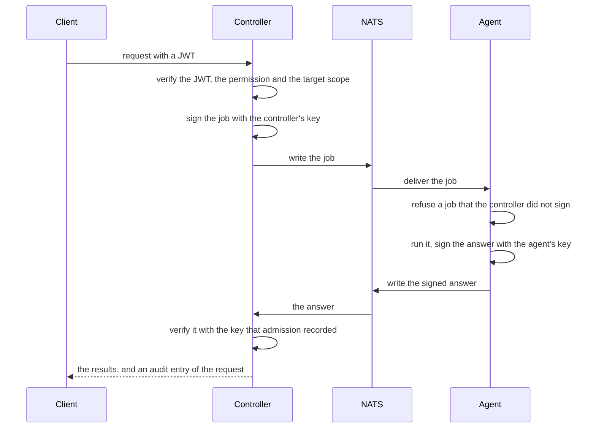

# Security

Four things control what can occur on a host:

- the identity of the client that sends a request
- the operations that the client can do
- the agent that can answer
- the commands that the agent can run

Each request makes a record.

## Who sends the request

Each API request has a JWT. The first key of
`controller.api.security.signing_keys` signs it (HS256), and puts its `id` in
the `kid` header. Each key of the list verifies the tokens with its `id`.
`osapi controller token generate` makes a token with roles, a subject and, if
you want, a fixed list of permissions. `osapi controller token validate` shows
what a token gives. The CLI sends the token in
`controller.client.security.bearer_token`. Only the liveness probe and the
readiness probe, `/api/health` and `/api/health/ready`, answer without a token.

## What the client can do

Each operation needs one permission, for example `sysctl:read` or
`command:execute`. A token gets permissions from its roles, or it has its own
list of permissions:

- **Built-in roles**: `admin`, `operator`, `automation`, `auditor`, `read` and
  `observer`. `osapi controller role list` prints each permission and the role
  that gives it, as the binary that you run has them.
- **Custom roles.** You define them in `controller.api.security.roles`. Each one
  is a list of permissions. A custom role with the name of a built-in role
  replaces the built-in role.
- **Behaviors** add their own permissions, `<name>:<verb>`, such as `dns:read`
  and `dns:write`. A rule gives them to the built-in roles, as
  [Authentication](../operate/secure/authentication.md) tells.

osapi divides the permissions by what an operation can do, not by area. To run a
command (`command:execute`) and to run a shell (`command:shell`) are two
different permissions. Only `admin` has them.

## Which agent can answer

The **machine ID** of an agent identifies it. The hostname does not. osapi sends
jobs to the machine ID. Thus, when a host gets a new name, its work does not go
to a different host.

PKI is always on. An agent gets no work until an administrator accepts it:

1. When the agent starts for the first time, it makes an Ed25519 signing key
   pair and an X25519 encryption key in `agent.pki.key_dir`.
1. It sends an enrollment request and waits. `osapi client admission list` shows
   it as pending.
1. An administrator runs `osapi pki key get --name agent` on the machine, and
   admits it with the fingerprint that the command prints. The controller admits
   it only when the fingerprint is the one of the two keys in the request. Or
   the controller admits each agent itself, with `controller.pki.auto_admit`.
1. After that, the controller signs each job. The agent refuses a job that the
   controller did not sign. The agent signs its results and its heartbeats.

osapi stops sending work to an agent in two cases. The first case is a heartbeat
that the accepted key of the agent did not sign. The second case is a hostname
that a different admitted machine holds. A host that only changed its hostname
keeps its work: the record of the machine takes the new hostname.

When a key changes, a grace period (`controller.pki.rotation_grace_period`)
starts. During it, osapi accepts the old key and the new key.

`osapi client admission revoke` removes the stored key of an admitted machine.
After that, osapi does not accept anything that the agent signs.

## What the agent can run

By default, the agent runs as a user without privileges. With
`agent.privilege_escalation` on, it runs the commands that change the host
through `sudo`. It runs reads without `sudo`. The sudoers drop-in lists the
programs and arguments that the agent can run. Linux capabilities can replace
sudo where they include the operation.

When the agent starts, a preflight lists the sudo rules one time. The agent does
not start only when sudo needs a password. A program without a rule, or a
missing capability, gives a warning. Only the operations that need it fail.

osapi stores a job and runs it later. Thus the API and the provider on the host
both check input that becomes a file path, a file name or a command argument.
The API checks it before it puts the job on the queue. The provider checks it
before it uses it. A secret goes to a command on its standard input, never as an
argument. All commands run through one place, with a timeout of ten minutes or
less.

## Audit

osapi records each authenticated request, whatever the result. The record gives:

- the client, with its roles and permissions
- the method, the path and the status
- the time that the request took
- a summary of the request

In the summary, osapi replaces the fields that hold secrets, for example
`password`, `token` and `secret`, with `[redacted]`. The record is a NATS stream
that osapi keeps for `nats.audit.max_age`. `osapi client audit list` and
`osapi client audit export` read it.

## Design details

- [Permissions](https://github.com/osapi-io/specs/blob/main/components/osapi/permissions.md),
  [agent identity](https://github.com/osapi-io/specs/blob/main/components/osapi/agent-identity.md),
  [running commands](https://github.com/osapi-io/specs/blob/main/components/osapi/exec.md)
  and
  [audit](https://github.com/osapi-io/specs/blob/main/components/osapi/audit.md).
- [Authentication](../operate/secure/authentication.md),
  [Agent identity and PKI](agent-identity.md),
  [Agent hardening](../operate/secure/agent-hardening.md) and
  [Audit logging](../operate/secure/audit-logging.md) tell how to configure each
  one.
