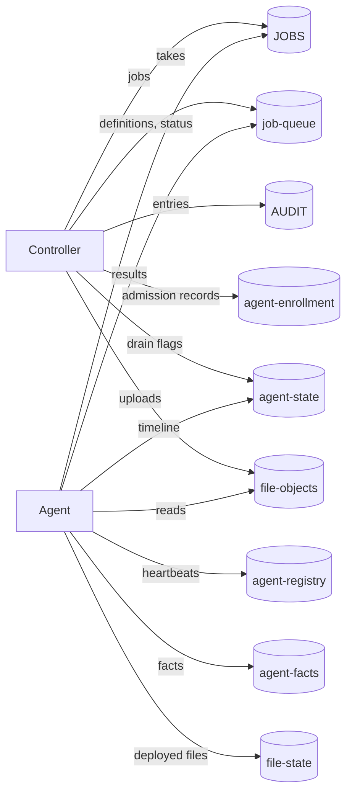

# State and storage

osapi keeps its state only in NATS JetStream. It has no database. The controller
and the agents keep no state, except what they write to JetStream and the files
that an agent manages on its own host. If you lose a controller, you lose
nothing. If you lose JetStream, you lose all the stores below.

The NATS setup makes each store when osapi starts, if the store does not exist.
The `nats` section of the configuration sets the name of each store. The table
gives the names in the default configuration. The same section also sets the
retention of each store, and its storage, memory or file.

| Store              | Kind         | Holds                                                            | Kept for                 | If you lose it                                             |
| ------------------ | ------------ | ---------------------------------------------------------------- | ------------------------ | ---------------------------------------------------------- |
| `JOBS`             | Stream       | A notification per job, on `jobs.query.*` and `jobs.modify.*`    | `nats.stream.max_age`    | Jobs that no agent received do not run                     |
| `JOBS-DLQ`         | Stream       | Delivery advisories of jobs that ran out of retries              | `nats.dlq.max_age`       | The record of which jobs gave up                           |
| `job-queue`        | KV           | Each job's definition, its status events and each agent's result | `nats.kv.ttl`            | The job history. `job get` and `job retry` stop for them   |
| `agent-registry`   | KV           | Heartbeats from every agent, controller and NATS server          | `nats.registry.ttl`, 30s | Nothing. Components write it again every 10 seconds        |
| `agent-facts`      | KV           | Each agent's facts: interfaces, routes and the like              | `nats.facts.ttl`         | Nothing. Agents collect the facts again                    |
| `agent-state`      | KV           | Operator actions: drain flags and timeline events                | No expiry                | The drains stop, and the timeline is gone                  |
| `file-objects`     | Object store | Files uploaded with `osapi client file upload`                   | Until deleted            | The uploaded files. A deploy of them fails                 |
| `file-state`       | KV           | What osapi deployed to each host, with each file's checksum      | No expiry                | osapi does not know which files on a host it manages       |
| `AUDIT`            | Stream       | One entry per authenticated API request, and per join over NATS  | `nats.audit.max_age`     | The audit trail                                            |
| `agent-enrollment` | KV           | Agents waiting to be accepted, and accepted agents' keys         | No expiry                | Each agent must enroll again, and you must accept it again |

If the configuration does not name a store that an operation needs, osapi does
not make the store. It also disables the operations that use the store. For
example, without `file-state`, the agent disables its file operations, and the
sysctl behavior reports `skipped`. The controller makes `agent-enrollment`.

## What is on the hosts

An agent writes the files that it manages, for example `osapi-<key>.conf` under
`/etc/sysctl.d`. It records each file in `file-state`, with its checksum. With
that record, osapi knows its own files from the files that it did not write. It
lists, updates and removes only the files that it recorded. It does not touch
the other files. An agent also keeps its PKI key pair in `agent.pki.key_dir`.

## Namespaces

More than one osapi deployment can use one NATS server. Each deployment sets a
namespace in `nats.server.namespace`, `controller.nats.namespace` and
`agent.nats.namespace`. The namespace is a prefix on each subject and each store
name. Thus the jobs, the registries and the audit logs of two deployments do not
mix.

## Sizing

Each agent makes JetStream consumers for its machine ID, for `_any`, for `_all`
and for each prefix of each label, for reads and for changes. One label with
three levels makes six consumers. Five such labels, plus the base subjects, make
about thirty-six consumers for each agent.

Use an external NATS cluster for a fleet of hundreds of hosts, or when the
stores must continue to operate when a host stops. Set file storage and replicas
in the section of each store. [Deployment](../operate/plan.md) gives the
layouts.

## Design details

- [The job system](https://github.com/osapi-io/specs/blob/main/components/osapi/job-system.md)
  tells how osapi keys the jobs, the status events and the responses.
- [Configuration](https://github.com/osapi-io/specs/blob/main/components/osapi/configuration.md)
  gives each store setting. `osapi config list` gives their values on a host.
