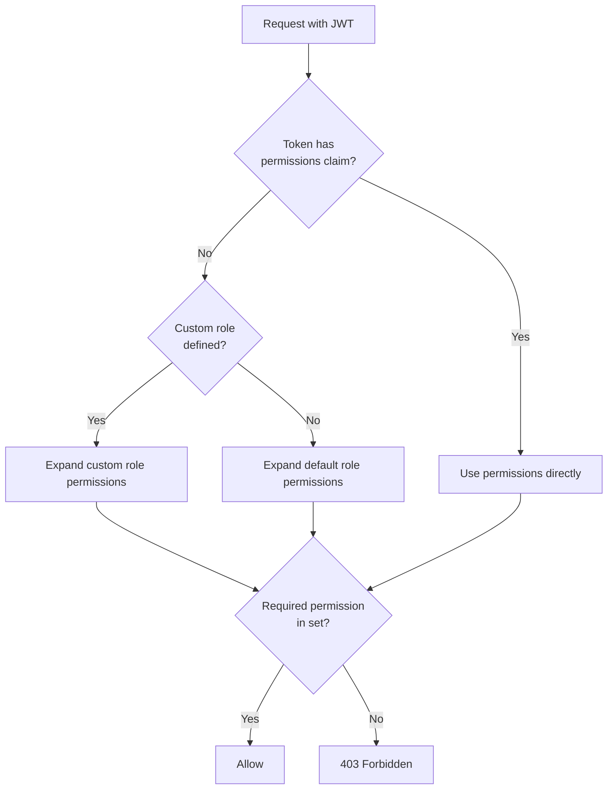

# Authentication & RBAC

OSAPI uses JWT bearer tokens for authentication and fine-grained `resource:verb`
permissions for authorization. Every API endpoint (except health probes)
requires a valid token.

## How It Works

### JWT Signing

OSAPI uses **HMAC-SHA256 (HS256)** symmetric signing. The same `signing_key` is
used to both create and verify tokens:

```
osapi token generate ──[signs with signing_key]──> JWT
Client ──[sends JWT]──> API Server ──[verifies with signing_key]──> Allow/Deny
```

Only someone who knows the signing key can create valid tokens. If the signing
key is compromised, rotate it immediately -- all previously issued tokens become
invalid.

The key must be at least 32 characters; a shorter value fails config validation
at startup. Generate one with `openssl rand -hex 32`.

### Token Structure

A token carries three pieces of authorization data:

- **Roles** (`roles` claim, required) -- one or more of `admin`, `write`, `read`
- **Permissions** (`permissions` claim, optional) -- direct `resource:verb`
  grants that override role expansion
- **Subject** (`sub` claim) -- user identity for audit logging

Generate tokens with the CLI. See [CLI Reference](../usage/cli/token/token.mdx)
for usage and examples, or the [API Reference](/category/api) for the REST
endpoints.

### Permission Resolution

When a request arrives, the middleware resolves the caller's effective
permissions:



## Roles and Permissions

There are three built-in roles, `admin`, `write` and `read`. To see every
permission each grants, as the binary you run has them, list them:

```bash
osapi token roles
```

That list is the reference, because it changes as behaviors are added. A
behavior's permissions are `<name>:read` and `<name>:write`: `admin` and `write`
grant both, and `read` grants the read permission.
[`token roles`](../usage/cli/token/roles.md) has its output.

`command:execute` and `command:shell` are two distinct permissions: the former
guards the argv-only `exec` endpoint, the latter guards the `/bin/sh -c` based
`shell` endpoint. Only `admin` includes either by default. A custom role or
token that grants `command:execute` does **not** also gain shell access -- add
`command:shell` explicitly if it should. See
[Command Execution](command-execution.md#security-model) for details.

### Custom Roles

Define custom roles in the configuration to create new role names or override
default permission mappings:

```yaml
controller:
  api:
    security:
      roles:
        ops:
          permissions:
            - node:read
            - health:read
        netadmin:
          permissions:
            - network:read
            - network:write
            - health:read
```

## Configuration

```yaml
controller:
  api:
    security:
      # HS256 signing key (REQUIRED, minimum 32 characters)
      # Generate with: openssl rand -hex 32
      signing_key: '<64-char hex string>'

  client:
    security:
      # JWT for client requests (REQUIRED)
      # Generate with: osapi token generate
      bearer_token: '<jwt>'
```

See [Configuration](../usage/configuration.md#permissions) for the full
reference including custom roles and CORS settings.

## Agent-Level Authentication (PKI)

JWT-based auth secures the REST API between clients and the controller. For
agent-level trust -- ensuring that only approved agents process jobs and that
jobs originate from a trusted controller -- OSAPI provides an optional PKI
enrollment system.

When PKI is enabled, each agent generates an Ed25519 key pair and submits an
enrollment request. An administrator accepts or rejects the request,
establishing cryptographic trust. The controller signs jobs with its private
key, and agents verify the signature before processing.

PKI is complementary to JWT auth: JWTs authenticate API callers, while PKI
authenticates the agent-controller relationship over NATS. See
[Agent Identity & PKI](agent-identity.md) for full details.

## Related

- [Agent Identity & PKI](agent-identity.md) -- machine-ID identity, PKI
  enrollment, job signing
- [CLI Reference](../usage/cli/token/token.mdx) -- token generation and
  validation commands
- [API Reference](/category/api) -- REST API documentation
- [Configuration](../usage/configuration.md) -- full configuration reference
- [Architecture](../architecture/architecture.md) -- system design overview
