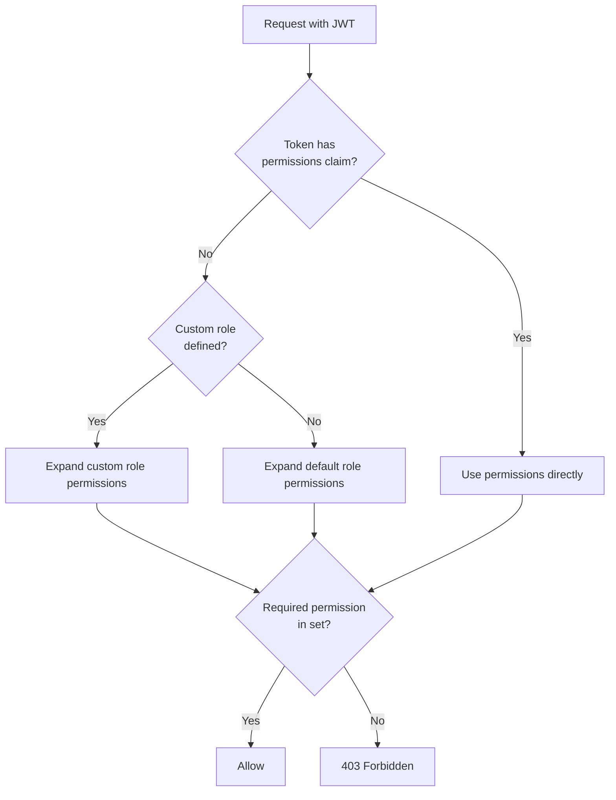

# Authentication & RBAC

OSAPI uses JWT bearer tokens for authentication and fine-grained `resource:verb`
permissions for authorization. Every API endpoint (except health probes)
requires a valid token.

## How it works

### JWT signing

osapi uses **HMAC-SHA256 (HS256)** symmetric signatures. The same `signing_key`
makes and verifies tokens:

```
osapi token generate ──[signs with signing_key]──> JWT
Client ──[sends JWT]──> API Server ──[verifies with signing_key]──> Allow/Deny
```

Only a person who knows the signing key can make valid tokens. If somebody else
gets the signing key, change it immediately. Then all tokens made before become
invalid.

The key must have 32 characters or more. A shorter value fails the config
validation when osapi starts. Make one with `openssl rand -hex 32`.

### Token structure

A token carries three pieces of authorization data:

- **Roles** (`roles` claim, required): one or more of `admin`, `write` and
  `read`
- **Permissions** (`permissions` claim, optional): direct `resource:verb`
  permissions. They replace the permissions of the roles
- **Subject** (`sub` claim): the identity of the user, for the audit log

Generate tokens with the CLI. Refer to
[CLI Reference](../usage/cli/token/token.mdx) for usage and examples, or the
[API Reference](/category/api) for the REST endpoints.

### Permission resolution

When a request arrives, the middleware resolves the caller's effective
permissions:



## Roles and permissions

There are six built-in roles, one for each kind of person or program that uses
osapi: `admin`, `operator`, `automation`, `auditor`, `read` and `observer`. A
config can add more. To see the roles, and then each permission that a role
grants, as the binary you run has them:

```bash
osapi token roles list
osapi token roles get --name operator
```

Use these commands, because the permissions change when osapi gets new behaviors
and endpoint groups. The permissions of a behavior are `<name>:read` and
`<name>:write`. An endpoint group has `<group>:read` for a `GET` and
`<group>:write` for the other HTTP methods. A rule gives the built-in roles
their permissions. No list of roles is kept by hand:

- `admin` gets each permission.
- `operator` gets each `read` and each `execute` permission that is not admin
  only: it acts, such as a restart, a signal or a reboot, but changes no
  configuration.
- `automation` gets each `read` and each `write` permission that is not admin
  only: it changes the configuration, but runs no action.
- `read` gets each `read` permission that is not admin only. Logs, files and
  process arguments can hold secrets, and `read` has them.
- `auditor` gets `audit:read`, `trace:read`, `job:read` and `health:read`.
- `observer` gets `health:read`, `status:read` and `agent:read`, for a dashboard
  or a monitor.

A permission with the verb `shell` or `exec` is admin only, such as
`command:shell` and `container:exec`. So is `command:execute`, which runs any
command, and so are `user:write` and `schedule:write`, which reach root through
an account or a cron entry. A method that the DSL marks `AdminOnly` makes its
permission admin only too, such as `admission:write`, `agent:write` and
`audit:read`. An action of a behavior, such as a service restart, has the
permission `<name>:execute`. `file:write`, `package:write` and `sysctl:write`
stay with `automation`, and each of them can reach root: give `automation` only
to what you trust as root. [`token roles get`](../usage/cli/token/roles/get.md)
shows the result.

`command:execute` and `command:shell` are two different permissions.
`command:execute` controls the `exec` endpoint, which takes an argument list.
`command:shell` controls the `shell` endpoint, which uses `/bin/sh -c`. By
default, only `admin` has them. A custom role or token with `command:execute`
does **not** get shell access. If it must have shell access, add
`command:shell`. Refer to
[Command Execution](command-execution.md#security-model).

### Custom roles

Define custom roles in the configuration to create new role names or override
default permission mappings:

```yaml
controller:
  api:
    security:
      roles:
        ops:
          permissions:
            - status:read
            - health:read
        netadmin:
          permissions:
            - network:read
            - network:write
            - health:read
```

## Configuration

```yaml
controller:
  api:
    security:
      # HS256 signing key (REQUIRED, minimum 32 characters)
      # Generate with: openssl rand -hex 32
      signing_key: '<64-char hex string>'

  client:
    security:
      # JWT for client requests (REQUIRED)
      # Generate with: osapi token generate
      bearer_token: '<jwt>'
```

Refer to [Configuration](../usage/configuration.md#permissions) for all the
settings, with custom roles and CORS.

## Agent-Level authentication (PKI)

JWT authentication protects the REST API between the clients and the controller.
For trust between the agents and the controller, osapi has an optional PKI
enrollment system. It makes sure that only approved agents process jobs, and
that the jobs come from a trusted controller.

When PKI is enabled, each agent makes an Ed25519 key pair and sends an
enrollment request. An administrator accepts or rejects the request. That gives
cryptographic trust. The controller signs jobs with its private key. Agents
verify the signature before they process a job.

PKI is complementary to JWT auth: JWTs authenticate API callers, while PKI
authenticates the agent-controller relationship over NATS. Refer to
[Agent Identity & PKI](agent-identity.md) for full details.

## Related

- [Agent Identity & PKI](agent-identity.md): machine-ID identity, PKI
  enrollment, job signing
- [CLI Reference](../usage/cli/token/token.mdx): token generation and validation
  commands
- [API Reference](/category/api): REST API documentation
- [Configuration](../usage/configuration.md): full configuration reference
- [Architecture](../architecture/architecture.md): system design overview
