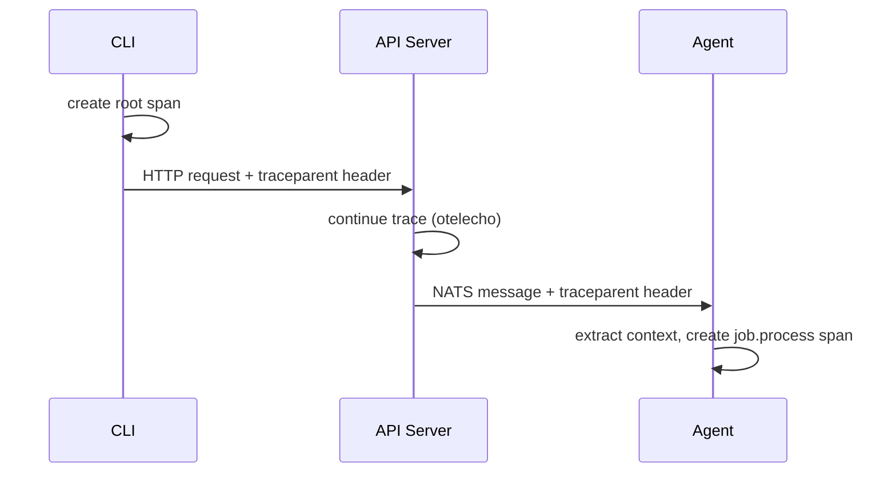

# Distributed tracing

osapi uses [OpenTelemetry](https://opentelemetry.io/) to send one trace ID
through each component of a request. When tracing is enabled, you can follow a
request from the CLI to the API server to the agent. Filter the logs on
`trace_id`.

## How it works



1. The **CLI** makes a root span and adds `traceparent` to the HTTP request.
1. The **API server** continues the trace in the `otelecho` middleware. Then,
   when it publishes a job notification, the nats-client adds the trace context
   to the NATS message headers automatically.
1. The **agent** reads the trace context from the NATS message headers. It makes
   a `job.process` span that connects its work to the original request.

All structured log lines include `trace_id` and `span_id` when a span is active,
so `grep trace_id=<hex>` shows the complete end-to-end flow.

## Debugging with traces

To trace a request end-to-end:

1. Run all three processes with `--debug` (or `telemetry.tracing.enabled: true`)
2. Execute a command: `osapi client node hostname`
3. Find the `trace_id` in any component's log output
4. Filter all logs: `grep trace_id=<hex>` across API server and agent output

This log output shows the same trace ID in each component:

```
# API Server
INF publishing job request  job_id=abc123 trace_id=e0fd287f... span_id=1a2b3c...
INF received job response   job_id=abc123 trace_id=e0fd287f... span_id=1a2b3c...

# Agent
INF processing job          job_id=abc123 trace_id=e0fd287f... span_id=4d5e6f...
INF job processing completed job_id=abc123 trace_id=e0fd287f... span_id=4d5e6f...
```

## Configuration

Tracing is off by default. The `exporter` field sets where osapi sends the
spans:

| `exporter` | Behavior                                                                                                                                          |
| ---------- | ------------------------------------------------------------------------------------------------------------------------------------------------- |
| _(unset)_  | Log correlation only. `trace_id` is in the structured logs, but osapi exports no spans                                                            |
| `stdout`   | Raw OpenTelemetry span JSON, printed directly to stdout without the structured logger. Useful to find a problem one time, but the output is large |
| `otlp`     | Spans sent via gRPC to a tracing backend (Jaeger, Tempo, etc.)                                                                                    |

The `--debug` flag auto-enables tracing with **no exporter** (log correlation
only). It does not enable the `stdout` exporter.

### Log correlation (recommended default)

Enable tracing so that `trace_id` and `span_id` are in the structured log lines.
osapi exports no spans. To follow a request, search the logs with grep.

```yaml
telemetry:
  tracing:
    enabled: true
```

### OTLP export (production)

Send spans to a tracing backend that you run, for example
[Jaeger](https://www.jaegertracing.io/) or
[Grafana Tempo](https://grafana.com/oss/tempo/). The `otlp_endpoint` is the gRPC
address of that backend.

```yaml
telemetry:
  tracing:
    enabled: true
    exporter: otlp
    otlp_endpoint: localhost:4317
```

:::note Today, the OTLP exporter uses a gRPC connection without TLS and without
authentication. This works for local and internal backends. It does not work for
cloud services that need TLS and API keys, for example Grafana Cloud, Honeycomb
and Datadog. Authenticated OTLP is planned. :::

Refer to [Configuration](../usage/configuration.md#every-setting) for the full
reference.

## Related

- [Configuration](../usage/configuration.md): full configuration reference
- [Architecture](../architecture/architecture.md): system design overview
- [Job System](job-system.md): how async job processing works
