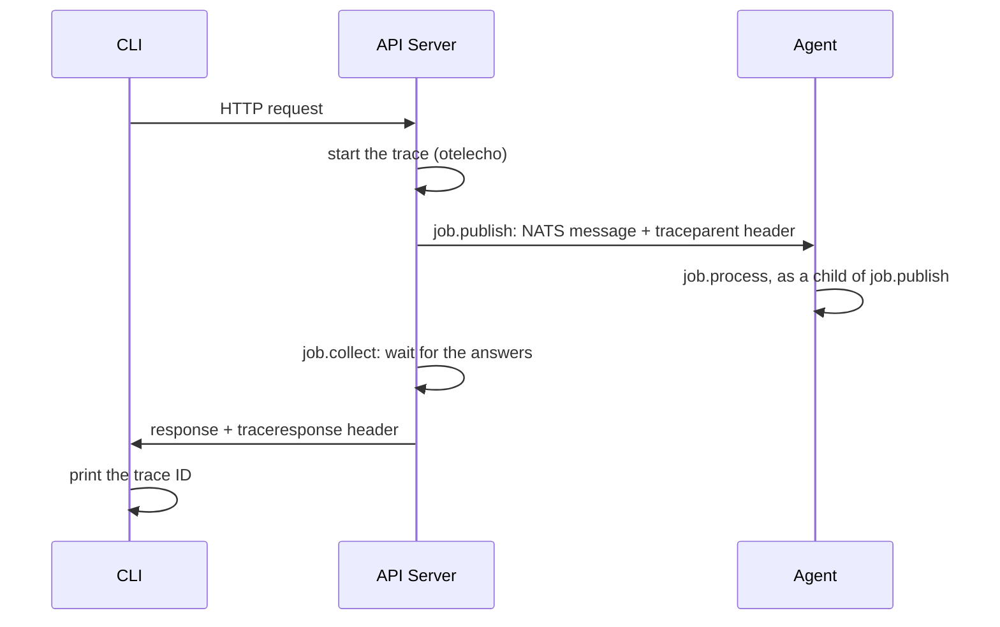

# Distributed tracing

osapi uses [OpenTelemetry](https://opentelemetry.io/) to send one trace ID
through each component of a request. When tracing is enabled, you can follow a
request from the CLI to the API server to the agent. Filter the logs on
`trace_id`.

## How it works



1. The **API server** starts the trace in the `otelecho` middleware. It opens
   `job.publish` when it stores and publishes the job. The nats-client adds the
   trace context to the headers of the NATS message.
1. The **agent** gets the message in a `nats.process` span, which continues the
   trace from the headers. It opens `job.process` under it.
1. The **API server** opens `job.collect` while it waits for the answers of the
   agents. It sends the trace back in the `traceresponse` header of the
   response.
1. The **CLI** prints the trace ID at the end of the summary line, after the job
   ID:

   ```text
   3 hosts: 2 ok, 1 skipped   job 8adc7e9f-040c-4d5b-8cb1-2e834158f746   trace 26e448c9dbe1c4a8d216a98c675079c9
   ```

The CLI needs no tracing configuration for this, and no access to the tracing
backend. Only the controller and the agents send spans. The Go SDK gives the
same ID: `resp.TraceID()`.

A person who develops osapi can also let the CLI send its own span. Give the CLI
`telemetry.tracing` with an `exporter`. Then the trace starts at the command,
for example `osapi client node package list`, and the controller continues it.
The trace ID is the same in each component. Without an exporter, the CLI sends
no trace context, so that a trace has no parent that never arrives.

## The span tree

A request to one host, or a broadcast such as `--target _all`, makes this tree.
A broadcast has one `job.process` for each agent:

```text
osapi-controller  GET /api/node/:hostname/package
├─ job.publish
│  ├─ kv.put                        (the job)
│  └─ nats.publish
│     ├─ osapi-agent  nats.process  (web-01)
│     │  └─ job.process
│     │     ├─ kv.get               (the job)
│     │     ├─ exec dpkg-query
│     │     └─ kv.put               (the answer)
│     └─ osapi-agent  nats.process  (web-02)
│        └─ job.process
│           └─ ...
├─ job.collect
│  └─ kv.watch                      (the answers)
├─ response.encode                  (the answer as JSON)
└─ response.write                   (the answer to the client, and its size)
```

A behavior adds `behavior.<name>.<method>` under `job.process`, and its commands
and file changes are under that span. A behavior that it requires is a span of
its own under it, for example `behavior.managedfile.update` under
`behavior.sysctl.create`. `osapi behavior get --name <name>` lists the spans
that a behavior can make. The tree above leaves out the `kv.put` of each status
event.

| Span                                                            | Service            | Attributes that tell you the most                                                                   |
| --------------------------------------------------------------- | ------------------ | --------------------------------------------------------------------------------------------------- |
| the command                                                     | `osapi-cli`        | The name is the command                                                                             |
| `GET /api/...`                                                  | `osapi-controller` | `http.route`, `http.response.status_code`, `osapi.target`                                           |
| `job.publish`                                                   | `osapi-controller` | `job.id`, `job.type`, `osapi.target`, `messaging.destination.name`                                  |
| `job.collect`                                                   | `osapi-controller` | `job.expected`, `job.answered`, `job.timed_out`; a `job.timeout` event names each silent agent      |
| `response.encode`                                               | `osapi-controller` | The time to encode the answer as JSON                                                               |
| `response.write`                                                | `osapi-controller` | `http.response.body.size`. The time to write the answer; a slow network or client makes it long     |
| `validate.target`, `target.resolve`                             | `osapi-controller` | `osapi.target`. A refresh of the agent cache that checks or resolves a target                       |
| `job.list`, `job.get`, `job.summary`, `job.retry`, `job.delete` | `osapi-controller` | `job.count` or `job.id`. A read or change of the job bucket, with its NATS calls under it           |
| `agent.list`, `agent.get`, `agent.timeline`                     | `osapi-controller` | `osapi.agent.count` or `osapi.target`. A read of the agent registry                                 |
| `enrollment.list`, `.accept`, `.reject`, `.remove`              | `osapi-controller` | `osapi.agent.count` or `osapi.agent.hostname`                                                       |
| `audit.list`, `audit.get`, `audit.export`                       | `osapi-controller` | `osapi.audit.count` or `osapi.audit.id`                                                             |
| `traces.read`                                                   | `osapi-controller` | `osapi.trace.id`, `osapi.trace.spans`. The read of a trace from Jaeger                              |
| `job.process`                                                   | `osapi-agent`      | `osapi.agent.hostname`, `osapi.agent.machine_id`, `host.arch`, `job.status`, `job.changed`          |
| `behavior.<name>.<method>`                                      | `osapi-agent`      | `osapi.behavior.name`, `osapi.behavior.method`, `osapi.behavior.outcome`                            |
| `exec <program>`                                                | `osapi-agent`      | `process.executable.name`, `osapi.exec.sudo`, `process.exit.code`. The arguments are not recorded   |
| `file.write`, `file.remove`, `file.chmod`                       | `osapi-agent`      | `file.path`, and `file.mode` and `file.size` where they apply. The content is not recorded          |
| `kv.<op>`, `objectstore.<op>`, `stream.<op>`                    | both               | `db.operation.name`, `db.namespace` (the bucket or the stream), `nats.kv.key` or `nats.object.name` |
| `nats.publish`, `nats.process`                                  | both               | `messaging.destination.name`, the subject                                                           |

Each span has `service.version`, the version of the binary that made it.

The NATS spans come from [nats-client](https://github.com/osapi-io/nats-client),
which makes one for each call to NATS inside a trace. A call outside a trace,
such as a heartbeat, makes no span, but the call is in the
`osapi_nats_client_operation_duration_seconds` metric. A file is written only
when its content changed, so a `file.write` span is a change; the behavior span
has `osapi.behavior.changed`.

A span has the error status when its work failed: a failed job, a command that
failed, or a `job.collect` with no answer. A host that skips a job is not an
error. Its `job.process` has `job.status` `skipped` and a `job.skipped` event
with the reason.

The health endpoints and the files of the UI have no spans. A probe and the UI
call them each few seconds, and their traces would hide the traces of the jobs.

## Read a trace from the CLI or the UI

You can read a trace without access to the tracing backend. The controller reads
it for you:

```bash
osapi client telemetry trace get --id 26e448c9dbe1c4a8d216a98c675079c9
```

```text
Trace:
  ID:        26e448c9dbe1c4a8d216a98c675079c9
  Started:   2026-11-15 15:18:49
  Duration:  20ms
  Services:  osapi-controller, osapi-agent

Spans (8):
  SPAN                                     ON          DURATION  STATUS     DETAIL
  POST /api/next/node/:hostname/sysctl     controller  20ms      ok         200
  ├─ job.publish                           controller  2ms       ok         behavior.sysctl.create to debian-1
  │  └─ job.process                        debian-1    11ms      completed
  │     └─ behavior.sysctl.create          debian-1    5ms       changed    key=vm.swappiness
  │        ├─ behavior.managedfile.update  debian-1    1ms       changed
  │        │  └─ file.write                debian-1    147µs     ok         /etc/sysctl.d/osapi-vm.swappiness.conf
  │        └─ exec sysctl                  debian-1    3ms       ok
  └─ job.collect                           controller  12ms      ok
  11 NATS calls left out, 20ms in all; --all shows them.
```

- **ON** is where the span ran: the agent of the `job.process` above it, or else
  the role of the service that made it, `controller`, `agent` or `cli`.
- **STATUS** is the job status on a `job.process`, `changed` or `unchanged` on a
  behavior write, and `ok` or `error` on the other spans.
- **DETAIL** is the error of a failed span. On the other spans, it is what the
  span acted on: the inputs that a behavior records, a file, the operation and
  target of a job, or the size of the answer.

The NATS calls are the bookkeeping of the job queue: the agent reads the job,
writes its status as it goes, and writes its answer. The command leaves them out
and counts them. `--all` shows them, and says what each key is for, for example
`status: started`, `response` or `file record`, instead of the key.

The **Traces** page of the UI, in the Admin menu, shows the same tree with a
timing bar for each span, and a check box that shows the NATS calls.
`/admin/traces/<id>` opens one trace.

The controller reads the trace from the query API of Jaeger at
`telemetry.tracing.url`, the address where a person opens Jaeger. Without that
setting, the command answers that no tracing backend is configured. The backend
gets the spans a few seconds after the request, so a trace that ran a moment ago
can be not found. Run the command again after a few seconds. The command needs
`trace:read`, which each built-in role has.

## Read a trace in Jaeger

1. Copy the trace ID from the summary line of the command.
1. Put it in the search box at the top of Jaeger. Jaeger opens the trace.
1. Each `job.process` shows its host in `osapi.agent.hostname`. A red span
   failed. Open it, and read the error in its status.
1. Compare `job.expected` and `job.answered` on `job.collect`. When they are
   different, the `job.timeout` events name the agents that did not answer.

To find traces without an ID, open **Search**. Set **Service** to
`osapi-controller`, and set **Tags** to one of these:

- `job.id=<the job ID>`, for one job
- `osapi.agent.hostname=web-01`, for the work of one host

An audit entry has `trace_id`. Put it in the search box of Jaeger to open the
trace of that request.

## Debugging with traces

To trace a request end-to-end:

1. Run all three processes with `--debug` (or `telemetry.tracing.enabled: true`)
2. Execute a command: `osapi client node hostname`
3. Find the `trace_id` in any component's log output
4. Filter all logs: `grep trace_id=<hex>` across API server and agent output

This log output shows the same trace ID in each component:

```
# API Server
INF publishing job request  job_id=abc123 trace_id=e0fd287f... span_id=1a2b3c...
INF received job response   job_id=abc123 trace_id=e0fd287f... span_id=1a2b3c...

# Agent
INF processing job          job_id=abc123 trace_id=e0fd287f... span_id=4d5e6f...
INF job processing completed job_id=abc123 trace_id=e0fd287f... span_id=4d5e6f...
```

## Configuration

Tracing is off by default. The `exporter` field sets where osapi sends the
spans:

| `exporter` | Behavior                                                                                                                                          |
| ---------- | ------------------------------------------------------------------------------------------------------------------------------------------------- |
| _(unset)_  | Log correlation only. `trace_id` is in the structured logs, but osapi exports no spans                                                            |
| `stdout`   | Raw OpenTelemetry span JSON, printed directly to stdout without the structured logger. Useful to find a problem one time, but the output is large |
| `otlp`     | Spans sent via gRPC to a tracing backend (Jaeger, Tempo, etc.)                                                                                    |

The `--debug` flag auto-enables tracing with **no exporter** (log correlation
only). It does not enable the `stdout` exporter.

### Log correlation (recommended default)

Enable tracing so that `trace_id` and `span_id` are in the structured log lines.
osapi exports no spans. To follow a request, search the logs with grep.

```yaml
telemetry:
  tracing:
    enabled: true
```

### OTLP export (production)

Send spans to a tracing backend that you run, for example
[Jaeger](https://www.jaegertracing.io/) or
[Grafana Tempo](https://grafana.com/oss/tempo/). The `otlp_endpoint` is the gRPC
address of that backend.

```yaml
telemetry:
  tracing:
    enabled: true
    exporter: otlp
    otlp_endpoint: localhost:4317
    # Where a person opens Jaeger. The controller also reads traces from it
    # for osapi client telemetry trace get and the Traces page.
    url: http://jaeger:16686
```

:::note Today, the OTLP exporter uses a gRPC connection without TLS and without
authentication. This works for local and internal backends. It does not work for
cloud services that need TLS and API keys, for example Grafana Cloud, Honeycomb
and Datadog. Authenticated OTLP is planned. :::

Refer to [Configuration](../usage/configuration.md#every-setting) for the full
reference.

## Related

- [Configuration](../usage/configuration.md): full configuration reference
- [Architecture](../architecture/architecture.md): system design overview
- [Job System](job-system.md): how async job processing works
