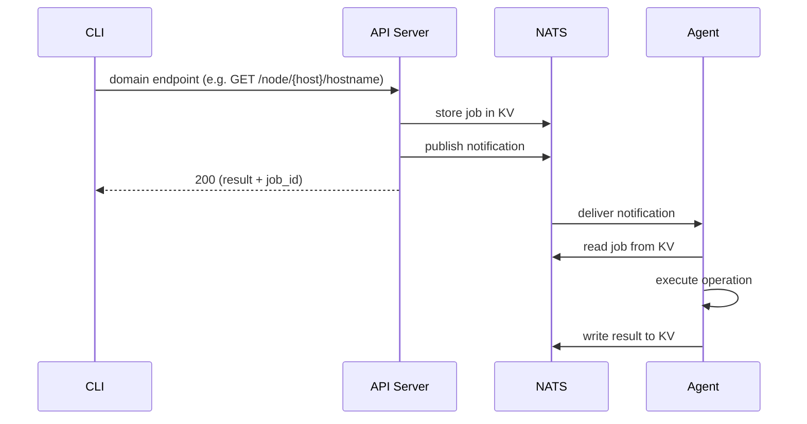
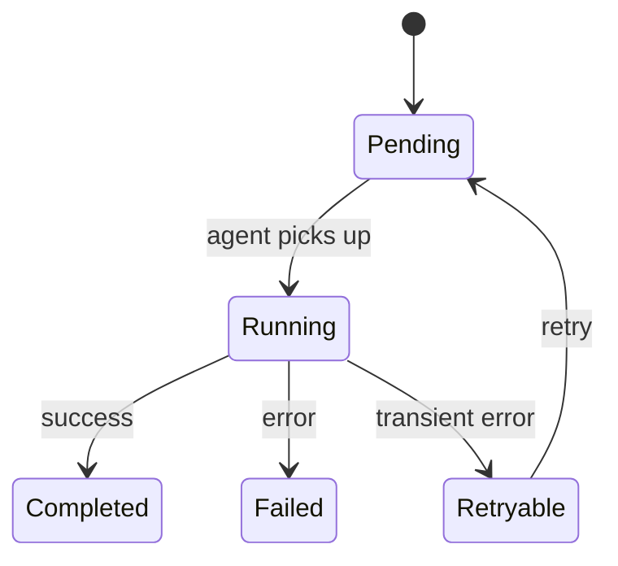

# Job system

The job system is the base of osapi. Each operation that reads or changes state
runs as an asynchronous job. Thus the API server needs no privileges, and the
agents run the operations on the target hosts.

## How it works

OSAPI uses a **KV-first, stream-notification** architecture built on NATS
JetStream:

1. The API server writes a job definition to a NATS KV bucket.
1. The API server publishes a notification to a NATS stream.
1. An agent receives the notification, reads the job from KV and runs the
   operation.
1. The agent writes the result to a response KV bucket.
1. The client asks the API server for the result. The API server reads it from
   KV.

## Job routing

Use these routing modes to send jobs to specific agents:

| Target        | Behavior                                        |
| ------------- | ----------------------------------------------- |
| `_any`        | Load-balanced across available agents (default) |
| `_all`        | Broadcast to every agent                        |
| `hostname`    | Sent to a specific host                         |
| `group:label` | Sent to all agents matching a label             |

Agents register with their hostname and optional key-value labels. Labels have
levels with dots between them. A label target matches its prefix: for example,
`group:web.dev` matches agents with `group: web.dev.us-east`.

## Job lifecycle

Jobs progress through a defined set of states:

When you call a domain endpoint, osapi makes a job automatically. After that,
you can list, examine, delete and retry the job through the job API and the CLI.
Refer to [CLI Reference](../../usage/cli/client/job/job.mdx) for usage and
examples, or the [API Reference](/gen/api/job-management-api-job-operations) for
the REST endpoints.

## When the job store is full

`nats.kv.max_bytes` limits the job bucket, 1 GiB by default. When a new job does
not fit, the controller removes the oldest finished jobs, a third of the jobs in
the bucket, and stores the new job. It never removes a job that is submitted or
processing. When the bucket has no finished job, the API answers 503 with the
reason `job_store_full`.

`osapi client health status` shows the limit of each bucket. Its `job_store`
check is an error, and the status is `degraded`, at 80% of the limit. The
metrics `osapi_job_store_bytes` and `osapi_job_store_max_bytes` give the size
and the limit, for an alert. A fleet that makes more jobs than the bucket holds
for one `nats.kv.ttl` sets a larger `nats.kv.max_bytes` or a shorter TTL.

## Configuration

<!-- osapi:config nats.kv agent.max_jobs agent.hostname agent.labels -->

| Key                 | Type   | Default                                                | Environment               | Description                                                                                                                                                                                       |
| ------------------- | ------ | ------------------------------------------------------ | ------------------------- | ------------------------------------------------------------------------------------------------------------------------------------------------------------------------------------------------- |
| `agent.hostname`    | string | none: empty is the host's own hostname                 | `OSAPI_AGENT_HOSTNAME`    | Agent hostname for direct routing. Defaults to the system hostname when empty.                                                                                                                    |
| `agent.max_jobs`    | int    | `10`                                                   | `OSAPI_AGENT_MAX_JOBS`    | Maximum number of concurrent jobs to process.                                                                                                                                                     |
| `agent.labels`      | map    | none: the labels of the host, which the operator picks | `OSAPI_AGENT_LABELS`      | Key-value labels for label-based routing (max 5). Values can be hierarchical with dot separators. Each label creates NATS consumers for prefix matching. See Job System Architecture for details. |
| `nats.kv.bucket`    | string | `job-queue`                                            | `OSAPI_NATS_KV_BUCKET`    | KV bucket for job definitions, status events and each agent's result.                                                                                                                             |
| `nats.kv.ttl`       | string | `1h`                                                   | `OSAPI_NATS_KV_TTL`       | How long a job's definition, status events and results stay in the bucket (Go duration), as nats setup sets it. Empty keeps them until max_bytes.                                                 |
| `nats.kv.max_bytes` | int    | `1073741824`                                           | `OSAPI_NATS_KV_MAX_BYTES` | Maximum total size of the bucket in bytes.                                                                                                                                                        |
| `nats.kv.storage`   | string | `file`                                                 | `OSAPI_NATS_KV_STORAGE`   | Storage backend: 'file' or 'memory'.                                                                                                                                                              |
| `nats.kv.replicas`  | int    | `1`                                                    | `OSAPI_NATS_KV_REPLICAS`  | Number of KV replicas.                                                                                                                                                                            |

<!-- /osapi:config -->

Refer to [Configuration](../../operate/plan.md#the-config-file) for all the
settings, with the NATS stream, consumer and DLQ settings.

## Permissions

The [job](../../reference/endpoints/fleet/job.md) reference page gives the
permission of each method.

## Related

- [CLI Reference](../../usage/cli/client/job/job.mdx): job commands
- [API Reference](/gen/api/job-management-api-job-operations): REST API
  documentation
- [Running Jobs](../../architecture/request-flow.md): targeting, statuses,
  polling, and what to monitor
- [Architecture](../../architecture/architecture.md): system design overview
