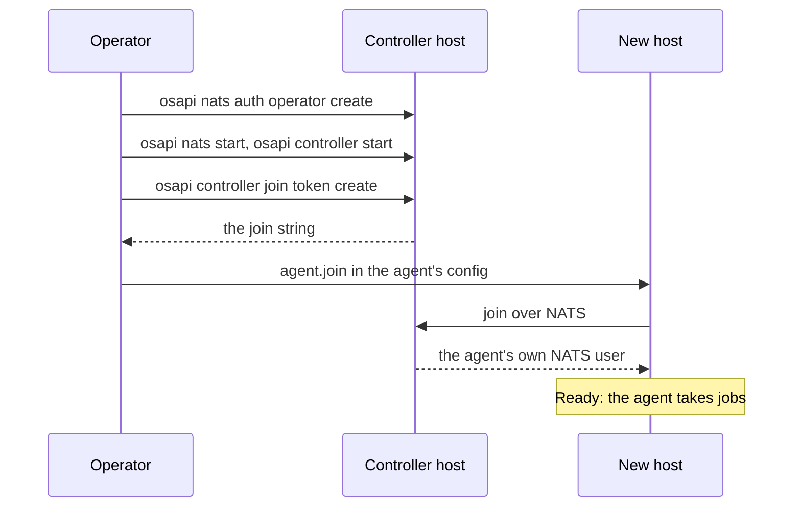

# A fleet on osapi's NATS

One host runs osapi's NATS server and the controller. Each other host runs an
agent. An agent needs only a join string: it needs to reach NATS, and nothing
else. osapi makes each credential.



## 1. Make the NATS auth

On the controller host:

```bash
osapi nats auth operator create --out /etc/osapi/nats
```

It writes an operator, an account for osapi, a credentials file for each osapi
role, and `osapi-nats.yaml`. Each file is mode 0600. Merge `osapi-nats.yaml`
into `/etc/osapi/osapi.yaml`, and set where the agents reach NATS:

```yaml
controller:
  join:
    url: nats://controller.example.com:4222
```

With `nats.server.tls`, use `tls://`: the join string then pins the certificate
of the server. Keep `/etc/osapi/nats/operator.nk` offline: it signs the
accounts.

`osapi nats auth password create` makes a user and a password for each role in
place of an operator. The steps after this one are the same.

## 2. Start NATS and the controller

```bash
osapi nats start &
osapi controller start &
```

NATS makes osapi's streams and buckets when it starts. The controller answers
each join.

## 3. Make a join token

```bash
osapi controller join token create --expires 24h --uses 50 --labels group=web
```

It prints the join string one time. Each agent that joins with it gets the
labels of the token, and the token admits it at once. The string has the address
of NATS, the namespace, and a bootstrap user that can send the join request and
nothing else.

## 4. Start each agent

On each host, the agent's config has the join string and nothing else that osapi
needs:

```yaml
agent:
  join: nats://controller.example.com:4222?creds=...&ns=osapi&token=osapi_jt_...
```

```bash
osapi agent start
```

At its first start the agent makes its keys, joins, and keeps its own NATS user
in `agent.pki.key_dir`. Each later start reads it, and does not join again.

## 5. See the fleet

```bash
osapi client agent list
osapi client node hostname get --target group:web
```

## Hosts that come and go

- Ship an image with an empty `/etc/machine-id`, so each host gets its own
  machine ID: it is the identity of the agent.
- Bake the join string into the image or the launch template, with a token that
  has enough uses and an expiry that outlives the image.
- Set `controller.pki.delete_after`, such as `24h`, so a host that went away
  leaves no record.
- Target hosts by their labels, such as `--target group:web`.

[Running osapi on your NATS](architecture/nats.md) is the reference for each
setting.
