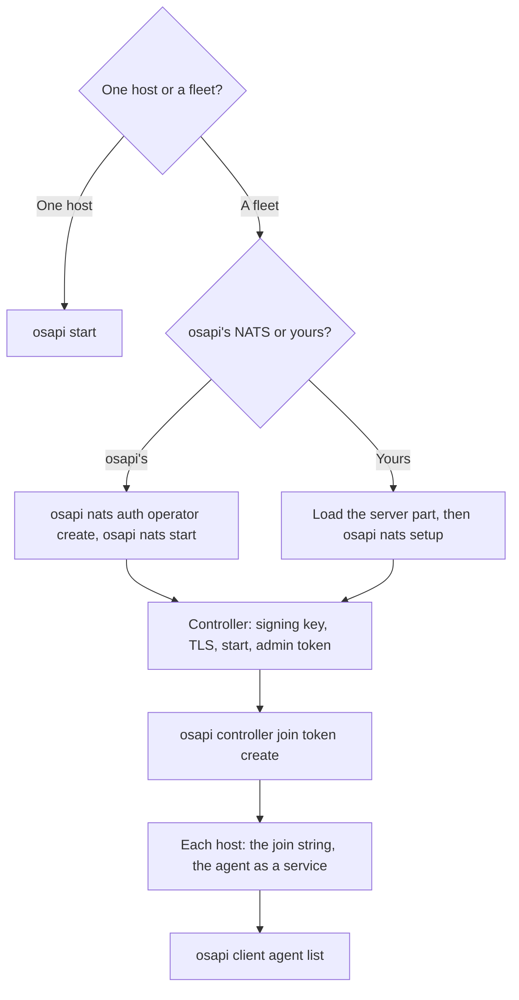

# Operate osapi

This section tells you how to run osapi for a fleet of hosts. Read the four
setup pages in order. Each page ends with the commands that show that its step
worked.

## Set up

| Step                           | What you decide                                     | What you get                              |
| ------------------------------ | --------------------------------------------------- | ----------------------------------------- |
| 1. [Plan](plan.md)             | Where each process runs. One host, or a fleet.      | A layout and a config file                |
| 2. [NATS](nats.md)             | osapi's NATS or yours. The type of auth. TLS.       | A NATS server with a user for each role   |
| 3. [Controller](controller.md) | The signing key, TLS for the API, who gets a token. | The API, the UI and an admin token        |
| 4. [Join hosts](join.md)       | A join token, or an admin who admits each host.     | Each host as an agent that starts at boot |

For one host only, `osapi start` does steps 2 to 4 in one process.
[Home](../intro.md#get-started) tells how.

## Run

| Page                                | What it tells                                                        |
| ----------------------------------- | -------------------------------------------------------------------- |
| [Run the fleet](fleet.md)           | See the fleet. Drain, rename, upgrade and remove hosts. Rotate keys. |
| [Secure](secure/authentication.md)  | Tokens and roles, agent hardening, the audit log, secrets.           |
| [Observe](observe/health-checks.md) | Health, metrics, tracing and notifications.                          |
| [Troubleshoot](troubleshoot.md)     | A symptom, its cause, and the command that shows it.                 |

## The commands that show the state

| Question                                   | Command                                                  |
| ------------------------------------------ | -------------------------------------------------------- |
| Which settings does this host use?         | `osapi config list`                                      |
| Is this config file correct?               | `osapi config validate -f <file>`                        |
| Which subjects does a NATS user need?      | `osapi nats permissions get --role <role>`               |
| Is each component healthy?                 | `osapi client health status`                             |
| Which hosts are admitted, and are they on? | `osapi client admission list`                            |
| Which agents run, with their labels?       | `osapi client agent list`                                |
| What occurred to one agent?                | `osapi client agent get --hostname <host>`, its timeline |
| What is the key of this host?              | `osapi agent key fingerprint`                            |

The UI shows the same state. The controller serves it at its API address. Sign
in with a token from [step 3](controller.md#4-make-an-admin-token).

## Where the rest is

- [Architecture](../architecture/architecture.md) tells how osapi works, and
  why. These pages tell only what to do.
- [Reference](../reference/reference.mdx) has each setting, command and
  endpoint. `osapi config list` shows each setting with its default.
