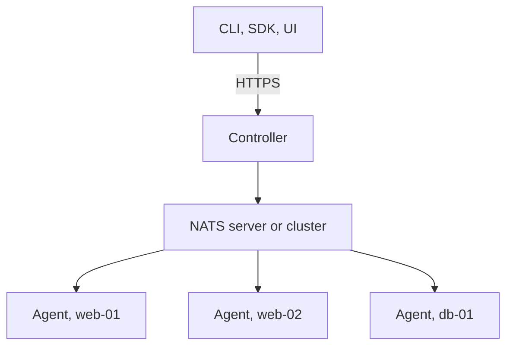

# 1. Plan a deployment

osapi has three processes, and one binary runs each of them. A deployment is a
decision about where each process runs, and which NATS server they share.

| Process    | Command                  | It listens on                      | It connects to |
| ---------- | ------------------------ | ---------------------------------- | -------------- |
| NATS       | `osapi nats start`       | 4222 for clients, 9092 for metrics | nothing        |
| Controller | `osapi controller start` | 8080 for the API and the UI, 9090  | NATS           |
| Agent      | `osapi agent start`      | 9091 for metrics only              | NATS           |

An agent listens on no port for work. It connects out to NATS, and takes its
jobs there. Thus a managed host needs to reach NATS, and nothing else.

## One host

`osapi start` runs NATS, the controller and an agent in one process. Use it for
one appliance, a test, or development. [Home](../intro.md#get-started) has the
steps.

## A fleet

Use one controller, one NATS server or cluster, and an agent on each managed
host. The controller and NATS can be on the same host.



Then select the NATS server ([2. NATS](nats.md)):

- **osapi's NATS.** `osapi nats start` runs it. osapi makes its users, its
  streams and its buckets. Use it for one site and up to some hundreds of hosts.
- **Your NATS.** You run the server or the cluster. Use it when the state must
  stay after you lose a host, or for more hosts: JetStream with file storage and
  replicas. [State and storage](../architecture/state.md) lists each store.

## Two fleets on one NATS

Two fleets, such as staging and production, can share one NATS server. Give each
fleet its own namespace ([Namespace](nats.md#namespace)). A fleet then does not
see the jobs or the state of the other fleet.

## In a container

The controller and NATS run in a container with no special settings. An agent in
a container manages the container, not the host: NTP, timezone, power and
service management report `skipped`. To manage a host, run the agent on the
host.

## The config file

Each process reads `/etc/osapi/osapi.yaml`. The `-f` flag names a different
file. An environment variable can set each key: `OSAPI_`, then the key in
capitals, with `_` in place of each dot. `controller.api.port` is
`OSAPI_CONTROLLER_API_PORT`. A variable has priority over the file.

The binary lists its own settings, with the default of each:

```bash
osapi config list                           # each key, its value, its source, its variable
osapi config get --key controller.api.port  # one key in full
osapi config validate -f /etc/osapi/osapi.yaml
```

`config validate` checks a file as `start` checks it, and starts nothing. For
each problem, it gives the key, the rule and the fix.

Durations are Go durations, such as `30s`, `5m` or `168h`. osapi does not accept
a `d` suffix. Bucket names and namespaces accept letters, digits, `-` and `_`
only.

## Check it

```bash
osapi config validate -f /etc/osapi/osapi.yaml
osapi config list | grep -v default    # the keys that this host sets
```

Next: [2. NATS](nats.md).
