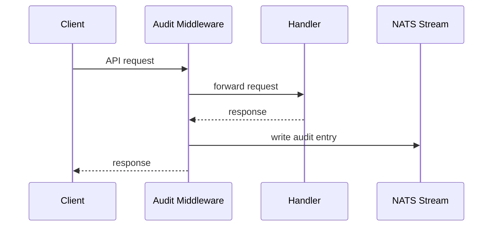

# Audit logging

OSAPI records a structured audit trail of every API request. Audit entries
capture who made the request, what they did, and how long it took. This provides
accountability and supports compliance requirements.

## How it works

A middleware in the API server records audit entries automatically. Each
authenticated request makes an audit entry. osapi stores it in its own NATS
JetStream stream. No application code needs to log audit events. The middleware
does it.



Each audit entry contains:

| Field             | Description                                      |
| ----------------- | ------------------------------------------------ |
| `id`              | Unique entry identifier (UUID)                   |
| `timestamp`       | When the request was made                        |
| `user`            | Identity from the JWT `sub` claim                |
| `roles`           | Roles from the JWT token                         |
| `method`          | HTTP method (`GET`, `POST`, etc.)                |
| `path`            | Request path (e.g., `/node/hostname`)            |
| `operation_id`    | OpenAPI operation ID (if available)              |
| `source_ip`       | Client IP address                                |
| `response_code`   | HTTP response status code                        |
| `duration_ms`     | Request processing time in milliseconds          |
| `trace_id`        | OpenTelemetry trace ID (when tracing is enabled) |
| `job_id`          | The job the request created, when it created one |
| `request_summary` | What the request asked for, redacted (see below) |
| `steps`           | The step tree of the job, for each host          |
| `chain`           | The steps of each host on one line               |

### What the request asked for

The client that called `command/shell` on a host, without the command, does not
tell what happened. Thus, for each method that changes something (`POST`, `PUT`,
`PATCH`, `DELETE`), the entry records `request_summary`. It is the request body
as JSON. osapi replaces the values of sensitive fields with `[redacted]`.

- **Redacted fields.** osapi finds them by name, at all levels, and upper case
  or lower case does not matter. Thus it also redacts a password in a list of
  users: `password`, `password_hash`, `secret`, `token`, `private_key`,
  `key_data`, `stdin`, `content`, `authorization`. It also redacts each input
  field of type `secret.Value`, by its name. A reference,
  `secret://<vault>/<key>`, stays, so the entry shows which secret a request
  used.
- **The list is a deny list, not an allow list.** osapi records new fields by
  default. A summary with only the fields that somebody remembered does not help
  after an incident. A field with a secret has the type `secret.Value`, and a
  test fails a `string` input field with a name on the list.
- **A summary has a limit** of 2 KB. When osapi cuts it, it adds `…[truncated]`.
  osapi does not read a body of more than 64 KB. The entry says so. It does not
  keep the upload.
- **A body that is not JSON.** osapi records its content type and size. It does
  not store the body.
- **A read records no summary.** A `GET` has nothing that osapi must keep.

`job_id` connects an entry to the status timeline of its job. Thus "who asked
for this" and "what the agents did" are one trail, not two. A request that makes
no job has no `job_id`.

### The chain of the job

`steps` and `chain` record the
[behavior chain](../../features/platform/behavior-chains.md) of the job: the
calls of other behaviors that the method made on each host. `steps` is the tree
of each host. `chain` is the same tree on one line for each host, as
`osapi client job get` prints it:

```text
Chain:      web-01: managedfile update (changed)
```

The job client gives the steps to the entry when it collects the response of a
host. The entry records the steps also when a step failed, and the job failed on
the host. A broadcast records the steps of each host that answered before the
request returned. A host that answers after the request returned, such as after
a timeout, is not in the entry. Its steps are in the job. A method that calls no
other behavior has no `steps` and no `chain`.

The entry keeps the steps for the time that it keeps the entry. Thus the chain
of an entry stays after the job expires from the job bucket.

### Changes that do not go through the API

Some changes do not go through the API, and the log has them too. Such an entry
has an `actor`, the kind of who made the change, an `action` and a `target`. Its
`user` is the name of the actor:

| Actor        | User                                          | Action                                                                                         | Target                                            |
| ------------ | --------------------------------------------- | ---------------------------------------------------------------------------------------------- | ------------------------------------------------- |
| `system`     | `auto_admit`                                  | `agent.admit`                                                                                  | the machine ID                                    |
| `system`     | `delete_after`                                | `agent.delete`                                                                                 | the machine ID                                    |
| `join-token` | the token's ID                                | `agent.join` (200, or 403 when refused)                                                        | the machine ID                                    |
| `agent`      | the machine ID                                | `agent.enroll.request` (202), the first request of a machine or one with a new key             | the machine ID                                    |
| `agent`      | the machine ID                                | `agent.nats.renew` (200, or 400, 403, 500 when refused)                                        | the machine ID                                    |
| `agent`      | the machine ID                                | `agent.rename`: a hostname that the agent reported, such as after a rename by hand             | the machine ID                                    |
| `local`      | the user of the operating system of a command | `jointoken.create`, `jointoken.revoke`, `token.generate`, `vaultkey.create`, `vaultkey.rotate` | the token's ID, the token's subject, or the vault |
| `local`      | the user of the operating system of a command | `natsauth.create`, `natskey.create`, `nats.setup`                                              | the directory, the key file, or the server        |

A local command connects to NATS as the controller does, and writes its entry to
the audit stream. An entry never has the token or a secret: only its ID. An
entry of a request through the API has no `actor`.

A pending agent asks again at each heartbeat. Only its first request, or one
with a new key, is an entry, so the log does not fill with repeats. A rename
through the API has the entry of its request, so `agent.rename` is only a rename
that no request made.

`osapi nats auth ... create` and `nats key create` often run before NATS starts.
Then the change is made, and the command warns that the audit log does not have
it: `the change is not in the audit log: NATS could not be reached`.

## Viewing audit logs

Query audit entries through the API or CLI. You can list recent entries
(paginated), get a specific entry by ID, or export all entries. Refer to
[CLI Reference](../../usage/cli/client/audit/audit.mdx) for usage and examples,
or the [API Reference](/gen/api/audit-log-api-audit) for the REST endpoints.

## Export

Export gets all audit entries in one response, with no pages. Use it to keep
entries for a long time. The audit entries in the NATS stream have a `max_age`
that you can set (30 days by default). An export keeps them before they expire.

Without `--json`, the command shows the entries as a table. To keep them, send
the JSON to a file:

```bash
osapi client audit export --json > audit.json

# Count the entries
jq '.items | length' audit.json

# Find the entries of a user
jq '.items[] | select(.user == "ops@example.com")' audit.json

# Write one entry on each line (JSONL)
jq -c '.items[]' audit.json > audit.jsonl
```

## Retention

osapi stores audit entries in a NATS JetStream stream, with retention settings
that you can set. When entries are older than `max_age`, or when the stream is
at its size limit, NATS removes the oldest entries automatically. If you must
keep entries for a long time, export them before they expire.

## Configuration

```yaml
nats:
  audit:
    stream: 'AUDIT' # JetStream stream name
    subject: 'audit' # Base subject prefix
    max_age: '720h' # 30-day retention (default)
    max_bytes: 52428800 # 50 MiB max stream size
    storage: 'file' # "file" or "memory"
    replicas: 1 # Number of stream replicas
```

When `stream` is empty, the controller keeps no audit log. Each audit endpoint
then answers 503, with a message that names `nats.audit.stream`.

When distributed tracing is enabled, each audit entry has a `trace_id` field.
Use it to find the OpenTelemetry trace of the entry.

Refer to [Configuration](../plan.md#the-config-file) for the full reference.

## Permissions

The [audit](../../reference/endpoints/audit/audit.md) reference page gives the
permission of each method.

## Related

- [CLI Reference](../../usage/cli/client/audit/audit.mdx): audit commands (list,
  get, export)
- [API Reference](/gen/api/audit-log-api-audit): REST API documentation
- [Configuration](../plan.md#the-config-file): full configuration reference
