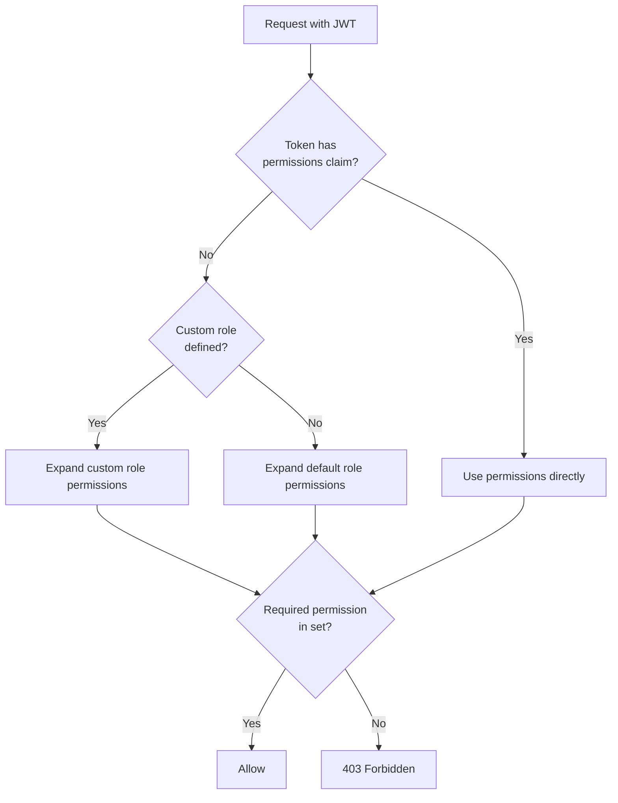

# Authentication & RBAC

OSAPI uses JWT bearer tokens for authentication and fine-grained `resource:verb`
permissions for authorization. Every API endpoint (except health probes)
requires a valid token.

## How it works

### JWT signing

osapi uses **HMAC-SHA256 (HS256)** symmetric signatures.
`controller.api.security.signing_keys` is a list of keys. Each key has an `id`
and a `key`:

```
osapi controller token generate ──[signs with the first key, kid = its id]──> JWT
Client ──[sends JWT]──> API Server ──[verifies with the key that kid names]──> Allow/Deny
```

- The first key of the list signs each new token, and puts its `id` in the `kid`
  header of the token. Put the newest key first.
- Each key of the list verifies the tokens that have its `id` as `kid`.
- The API refuses a token with no `kid`, or with a `kid` that the list does not
  have, with 401.

`osapi controller token validate` shows the `kid` of a token.

Only a person who knows a signing key can make valid tokens. If somebody else
gets a signing key, remove it from the list immediately. Then all tokens that it
signed become invalid.

Each key must have 32 characters or more. A shorter value fails the config
validation when osapi starts. Make one with `openssl rand -hex 32`. Two keys
cannot have the same `id`.

### Change the signing key

1. Add a new key at the start of the list, and restart the controller. New
   tokens get the new key. The tokens of the old key still work.
2. Make a new token for each client with `osapi controller token generate`.
3. Remove the old key when no client sends a token that it signed. A token
   expires after three months.

### Token structure

A token carries four pieces of authorization data:

- **Roles** (`roles` claim, required): one or more roles. A role is a built-in
  role (`admin`, `operator`, `automation`, `auditor`, `read` or `observer`) or a
  custom role of the config
- **Permissions** (`permissions` claim, optional): direct `resource:verb`
  permissions. They replace the permissions of the roles
- **Targets** (`targets` claim, optional): the hosts that the token can act on,
  as hostnames and labels. Refer to [Target scope](#target-scope)
- **Subject** (`sub` claim): the identity of the user, for the audit log

Generate tokens with the CLI. Refer to
[CLI Reference](../../usage/cli/controller/token/token.mdx) for usage and
examples, or the [API Reference](/category/api) for the REST endpoints.

### Permission resolution

When a request arrives, the middleware resolves the caller's effective
permissions:



### Target scope

A role applies to each host. To give a team access to its own hosts only, give
its token a target scope:

```bash
osapi controller token generate --subject team-web --roles operator \
    -t group:web -t web-01
```

Each target of the scope is a hostname, such as `web-01`, or a label, such as
`group:web`. `_all`, `_any` and `_local` cannot be in a scope. A token without
targets acts on each host.

The controller compares the target of each request with the scope:

- A label target is in the scope when the scope has the same label, or a label
  above it. `group:web` covers `group:web` and `group:web.dev`. It does not
  cover `group:webapp`.
- A host target is in the scope when the scope names the host. It is also in the
  scope when the agent of the host has a label that the scope covers.
- `_all` and `_any` are never in a scope, because they reach hosts outside it.

A request to a target outside the scope gets `403 Forbidden`, and no job goes to
a host. A retry of a job must name a target in the scope, because a retry
without a target goes to `_any`. The audit log records the scope of the token
with each entry, and the UI shows it on the Roles page and in each audit entry.

The scope also limits what the token reads of the jobs, the traces and the audit
log. The token sees a record only when the target of the record is in the scope:

- A job: its target, such as `group:web.dev` or `web-01`.
- An audit entry: the `{hostname}` of a `/api/node/{hostname}/` request. An
  entry of a request with no target, such as a read of the jobs, has no target.
- A trace: each `osapi.target` that its spans record. The token sees the trace
  only when a span records a target, and each target is in the scope.

A record with no target, or with the target `_all` or `_any`, is hidden from a
scoped token. A list leaves out each record that the token does not see, and its
counts include only the records that the token sees. A get, a delete or a retry
of a hidden record gets `404 Not Found`, the same as a record that does not
exist. A token without targets sees each record.

## Roles and permissions

There are six built-in roles, one for each kind of person or program that uses
osapi: `admin`, `operator`, `automation`, `auditor`, `read` and `observer`. A
config can add more. To see the roles, and then each permission that a role
grants, as the binary you run has them:

```bash
osapi controller role list
osapi controller role get --name operator
```

Use these commands, because the permissions change when osapi gets new behaviors
and endpoint groups. The permissions of a behavior are `<name>:read` and
`<name>:write`. An endpoint group has `<group>:read` for a `GET` and
`<group>:write` for the other HTTP methods. A rule gives the built-in roles
their permissions. No list of roles is kept by hand:

- `admin` gets each permission.
- `operator` gets each `read` and each `execute` permission that is not admin
  only, and `job:write`: it acts, such as a restart, a signal or a reboot, and
  retries or deletes a job, but changes no configuration.
- `automation` gets each `read` and each `write` permission that is not admin
  only: it changes the configuration, but runs no action.
- `read` gets each `read` permission that is not admin only. Logs, files and
  process arguments can hold secrets, and `read` has them.
- `auditor` gets `audit:read`, `trace:read`, `job:read` and `health:read`.
- `observer` gets `health:read`, `status:read` and `agent:read`, for a dashboard
  or a monitor.

Give each person and program the smallest role that does its work:

| Role         | For                                               | It may                                               | It may not                           |
| ------------ | ------------------------------------------------- | ---------------------------------------------------- | ------------------------------------ |
| `admin`      | the owner of the fleet                            | everything                                           |                                      |
| `operator`   | a person on call, who runs the fleet day to day   | read; restart, signal, reboot; retry or delete a job | change a configuration, admit a host |
| `automation` | a pipeline that applies configuration, such as CI | read; change configuration; use a secret in a change | run an action, such as a restart     |
| `read`       | a person who looks into a problem                 | read each thing that is not admin only               | change anything                      |
| `auditor`    | a person who reviews what occurred                | the audit log, traces, jobs and health               | read a host                          |
| `observer`   | a dashboard or a monitor                          | health, status and the list of agents                | read a host or a job                 |

Some permissions are admin only, because each one is the same as a shell as root
on a host, or decides who is trusted: `command:execute`, `command:shell`,
`docker:exec`, `schedule:write` (a cron entry runs a command), `user:write` (a
password), `secret:reveal`, and the admission and agent writes. A custom role in
the config can grant one of them to fewer people than `admin`.

The permissions of each built-in role, from the binary that wrote this page:

<!-- osapi:roles -->

| Role         | Permissions                                                                                                                                                                                                                                                                                                                                                                                                                                                                                                                                                                                                                                                                                                                                                                                                                                                                                                                                                                                                             |
| ------------ | ----------------------------------------------------------------------------------------------------------------------------------------------------------------------------------------------------------------------------------------------------------------------------------------------------------------------------------------------------------------------------------------------------------------------------------------------------------------------------------------------------------------------------------------------------------------------------------------------------------------------------------------------------------------------------------------------------------------------------------------------------------------------------------------------------------------------------------------------------------------------------------------------------------------------------------------------------------------------------------------------------------------------- |
| `admin`      | `health:read`, `trace:read`, `secret:use`, `secret:reveal`, `certificate:read`, `certificate:write`, `command:execute`, `command:shell`, `connectivity:execute`, `disk:read`, `dns:read`, `dns:write`, `docker:read`, `docker:write`, `docker:execute`, `docker:exec`, `file:read`, `file:write`, `group:read`, `group:write`, `hostname:read`, `hostname:write`, `image:read`, `image:execute`, `image:write`, `interface:read`, `interface:write`, `load:read`, `log:read`, `memory:read`, `ntp:read`, `ntp:write`, `os:read`, `package:read`, `package:write`, `power:execute`, `process:read`, `process:execute`, `schedule:read`, `schedule:write`, `service:read`, `service:write`, `service:execute`, `status:read`, `sysctl:read`, `sysctl:write`, `timezone:read`, `timezone:write`, `uptime:read`, `user:read`, `user:write`, `admission:read`, `admission:write`, `agent:read`, `agent:write`, `audit:read`, `catalog:read`, `job:read`, `job:write`, `pki:read`, `pki:write`, `secret:read`, `secret:write` |
| `operator`   | `health:read`, `trace:read`, `certificate:read`, `connectivity:execute`, `disk:read`, `dns:read`, `docker:read`, `docker:execute`, `file:read`, `group:read`, `hostname:read`, `image:read`, `image:execute`, `interface:read`, `load:read`, `log:read`, `memory:read`, `ntp:read`, `os:read`, `package:read`, `power:execute`, `process:read`, `process:execute`, `schedule:read`, `service:read`, `service:execute`, `status:read`, `sysctl:read`, `timezone:read`, `uptime:read`, `user:read`, `admission:read`, `agent:read`, `catalog:read`, `job:read`, `job:write`, `pki:read`, `secret:read`                                                                                                                                                                                                                                                                                                                                                                                                                    |
| `automation` | `health:read`, `trace:read`, `secret:use`, `certificate:read`, `certificate:write`, `disk:read`, `dns:read`, `dns:write`, `docker:read`, `docker:write`, `file:read`, `file:write`, `group:read`, `group:write`, `hostname:read`, `hostname:write`, `image:read`, `image:write`, `interface:read`, `interface:write`, `load:read`, `log:read`, `memory:read`, `ntp:read`, `ntp:write`, `os:read`, `package:read`, `package:write`, `process:read`, `schedule:read`, `service:read`, `service:write`, `status:read`, `sysctl:read`, `sysctl:write`, `timezone:read`, `timezone:write`, `uptime:read`, `user:read`, `admission:read`, `agent:read`, `catalog:read`, `job:read`, `job:write`, `pki:read`, `secret:read`, `secret:write`                                                                                                                                                                                                                                                                                    |
| `auditor`    | `health:read`, `trace:read`, `audit:read`, `catalog:read`, `job:read`                                                                                                                                                                                                                                                                                                                                                                                                                                                                                                                                                                                                                                                                                                                                                                                                                                                                                                                                                   |
| `read`       | `health:read`, `trace:read`, `certificate:read`, `disk:read`, `dns:read`, `docker:read`, `file:read`, `group:read`, `hostname:read`, `image:read`, `interface:read`, `load:read`, `log:read`, `memory:read`, `ntp:read`, `os:read`, `package:read`, `process:read`, `schedule:read`, `service:read`, `status:read`, `sysctl:read`, `timezone:read`, `uptime:read`, `user:read`, `admission:read`, `agent:read`, `catalog:read`, `job:read`, `pki:read`, `secret:read`                                                                                                                                                                                                                                                                                                                                                                                                                                                                                                                                                   |
| `observer`   | `health:read`, `status:read`, `agent:read`, `catalog:read`                                                                                                                                                                                                                                                                                                                                                                                                                                                                                                                                                                                                                                                                                                                                                                                                                                                                                                                                                              |

<!-- /osapi:roles -->

A permission with the verb `shell` or `exec` is admin only, such as
`command:shell` and `docker:exec`. So is `command:execute`, which runs any
command, and so are `user:write` and `schedule:write`, which reach root through
an account or a cron entry. A method that the DSL marks `AdminOnly` makes its
permission admin only too, such as `admission:write`, `agent:write` and
`audit:read`. An action of a behavior, such as a service restart, has the
permission `<name>:execute`. `file:write`, `package:write` and `sysctl:write`
stay with `automation`, and each of them can reach root: give `automation` only
to what you trust as root.
[`controller role get`](../../usage/cli/controller/role/get.md) shows the
result.

`command:execute` and `command:shell` are two different permissions.
`command:execute` controls the `exec` endpoint, which takes an argument list.
`command:shell` controls the `shell` endpoint, which uses `/bin/sh -c`. By
default, only `admin` has them. A custom role or token with `command:execute`
does **not** get shell access. If it must have shell access, add
`command:shell`. Refer to
[Command Execution](../../features/command/command-execution.md#security-model).

### Custom roles

Define custom roles in the configuration to create new role names or override
default permission mappings:

```yaml
controller:
  api:
    security:
      roles:
        ops:
          permissions:
            - status:read
            - health:read
        netadmin:
          permissions:
            - dns:read
            - dns:write
            - interface:read
            - interface:write
            - connectivity:execute
            - health:read
```

## Configuration

```yaml
controller:
  api:
    security:
      # HS256 signing keys (REQUIRED, minimum 32 characters each).
      # The first key signs; each key verifies the tokens with its id as kid.
      # Generate a key with: openssl rand -hex 32
      signing_keys:
        - id: '2026-11'
          key: '<64-char hex string>'

  client:
    security:
      # JWT for client requests (REQUIRED)
      # Generate with: osapi controller token generate
      bearer_token: '<jwt>'
```

Refer to [Configuration](../nats.md#select-the-type-of-auth) for all the
settings, with custom roles and CORS.

## Agent-Level authentication (PKI)

JWT authentication protects the REST API between the clients and the controller.
For trust between the agents and the controller, osapi has an optional PKI
enrollment system. It makes sure that only approved agents process jobs, and
that the jobs come from a trusted controller.

PKI is always on. Each agent makes an Ed25519 signing key pair and a P-256
encryption key, and sends an enrollment request. An administrator accepts or
rejects the request. That gives cryptographic trust. The controller signs jobs
with its private key. Agents verify the signature before they process a job.

PKI is complementary to JWT auth: JWTs authenticate API callers, while PKI
authenticates the agent-controller relationship over NATS. Refer to
[Agent Identity & PKI](../../architecture/agent-identity.md) for full details.

## Related

- [Agent Identity & PKI](../../architecture/agent-identity.md): machine-ID
  identity, PKI enrollment, job signing
- [CLI Reference](../../usage/cli/controller/token/token.mdx): token generation
  and validation commands
- [API Reference](/category/api): REST API documentation
- [Configuration](../plan.md#the-config-file): full configuration reference
- [Architecture](../../architecture/architecture.md): system design overview
