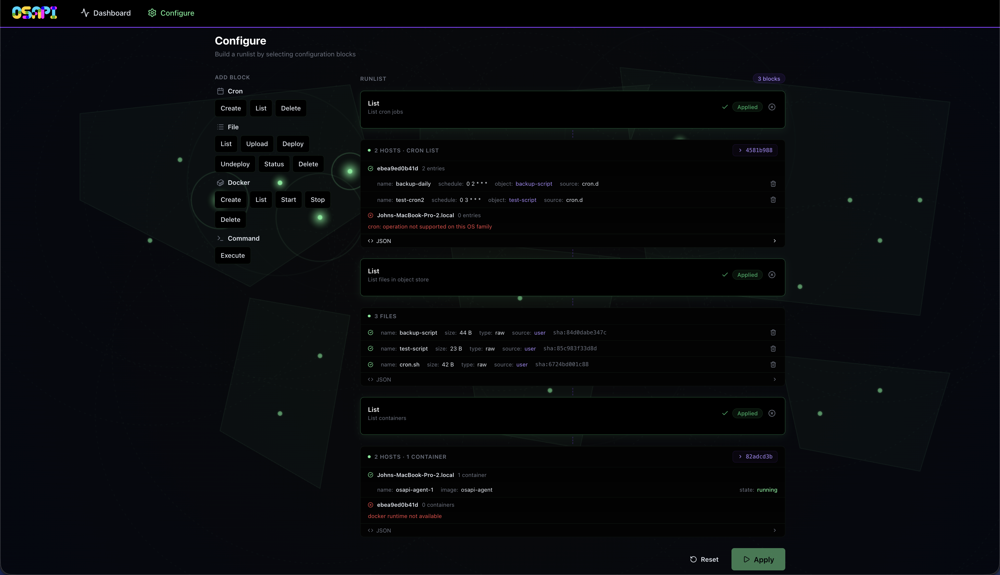

# ui

osapi's management dashboard, a React app the binary embeds and serves beside
the API. It reads the same API, with the same permissions, as the CLI and the
SDK.

  
  

- **Dashboard:** fleet health, the controller's and NATS's components, streams,
  buckets and an agent per card, with drain and undrain.
- **Configure:** an operation builder, one block per operation, each with its
  own target and result.
- **Its client** is generated from osapi's OpenAPI spec by
  [orval](https://orval.dev/), into `src/sdk/gen/`.

How it is built and run during development is in
[UI development](../docs/docs/sidebar/development/ui-development.md), and how it
is put together in [docs/architecture.md](docs/architecture.md). osapi's
[license](../LICENSE) and [AI policy](../AI_POLICY.md) cover it.
