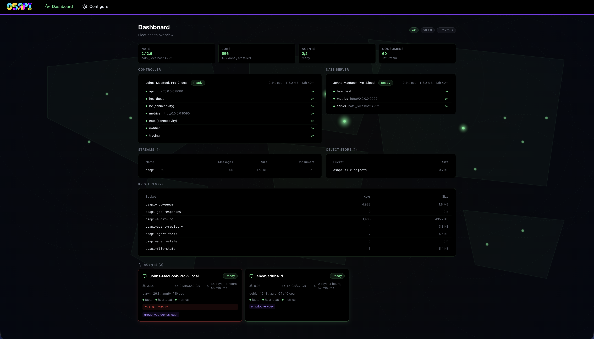

# ui

osapi's management dashboard, a React app the binary embeds and serves beside
the API. It reads the same API, with the same permissions, as the CLI and the
SDK.

  

- **Dashboard:** fleet health, the controller's and NATS's components, streams,
  buckets and an agent per card, with drain and undrain.
- **Behaviors:** what osapi manages on a host, by area, with a page for each
  behavior: its methods, their permissions, platforms, chains and examples.
- **Plans:** steps that run in order, each a method of a behavior with its own
  target, input and result. A plan exports as YAML.
- **Its client** is generated from osapi's OpenAPI spec by
  [orval](https://orval.dev/), into `src/sdk/gen/`.

[UI development](../docs/docs/sidebar/development/ui-development.md) tells how
to build and run it during development.
[docs/architecture.md](docs/architecture.md) tells how its parts fit together.
The osapi [license](../LICENSE) and [AI policy](../AI_POLICY.md) apply to it.
